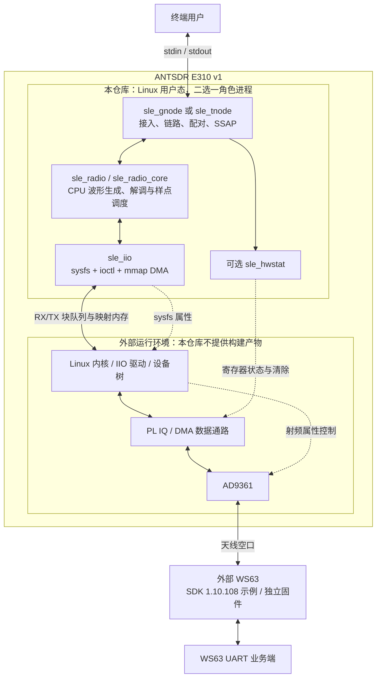
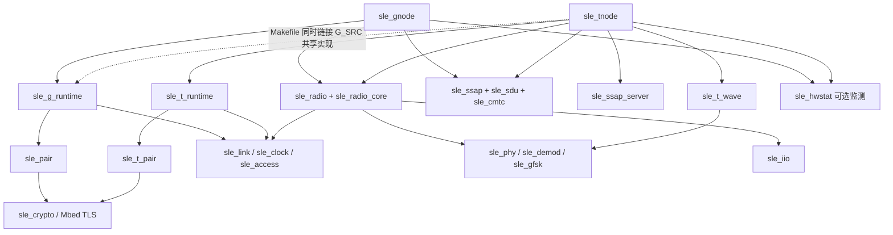

# 开源工程架构

本文面向需要理解或修改双角色程序的开发者，说明 `sle_gnode`、`sle_tnode` 的模块分工、数据路径、线程所有权和运行边界。描述以本公开工程源码为准；模块提供的编解码接口不等于应用已开放的业务能力。协议细节见 [协议栈](protocol-stack.md)，波形与样点时序见 [物理层](physical-layer.md)。

## 1. 目标与非目标

本工程在 **ANTSDR E310 v1** 的 Linux 用户态实现 SLE 协议子集，与 WS63 SDK 1.10.108 示例互通：选择一个角色进程，完成接入、连接事件调度、链路重传、运行时配对与加密，以及 SSAP 写入或通知。CPU 完成协议与 GFSK 波形处理，通过 IIO mmap DMA 搬运 IQ，利用已有 FPGA 数据通路和 AD9361 收发。运行入口只有 [sle_gnode.c](../sle-rt/sle_gnode.c) 与 [sle_tnode.c](../sle-rt/sle_tnode.c)，构建入口见 [Makefile](../sle-rt/Makefile)。

当前工程不以以下能力为交付目标：

- 完整、通用或经过符合性认证的 SLE 协议栈；多连接、多对端、所有 PHY 模式及所有调度组合。
- 任意 SDR 的即插即用后端，或 GNU Radio 流图；当前程序直接使用固定 IIO 设备与 Linux 接口。
- Linux 内核、设备树、SD 启动镜像、PL HDL 或 FPGA 位流的构建与部署。
- WS63 SDK、固件源码或烧录工具的随仓交付；本仓库只提供对端准备说明。
- 密钥数据库、跨进程会话恢复、持久化绑定或 Just Works 之外的用户身份认证。

范围依据：[源码说明](e310-source.md)、[硬件前提](hardware.md)、[互通约定](interoperability.md)、[对端构建说明](ws63-build.md)、[密钥生成](key-generation.md)。

## 2. 系统边界

下图表示用户态软件与外部运行环境的数据和控制接口。FPGA 可编程逻辑（PL）提供 IQ 与 DMA 数据通路，是运行前提；本仓库不提供其 HDL、位流或构建工程。

用户态通过 sysfs 设置 AD9361 的采样率、带宽、增益和本振频率（LO）；同相/正交（IQ）样点流通过 IIO 块分配、mmap、入队/出队接口，而不是使用 libiio 流 API 或对 IQ 设备执行普通 `read()/write()`。当前硬件绑定为 PHY `iio:device0`、TX `iio:device2`、RX `iio:device3`，要求现有内核驱动、设备树和 PL 与之兼容。设备编号不是动态发现的结果。定位：[sle_iio.h](../sle-rt/sle_iio.h) 的路径宏、[sle_iio.c](../sle-rt/sle_iio.c) 的 `sle_iio_open`，以及 [sle_radio.c](../sle-rt/sle_radio.c#L85) 的 `sle_rt_radio_setup`。

`sle_rt_radio_setup` 保存待修改的属性，拒绝附着到已启用的流，配置 4 MS/s、1.75 MHz 模拟带宽及 I/Q 扫描通道；结束时 `sle_rt_radio_restore` 恢复并读回核对。原始配置恢复属于程序生命周期的一部分。可选 `sle_hwstat` 通过 `/dev/mem` 读取既有硬件核状态，含粘滞状态的写一清除操作；它只用于硬件状态监测，不负责协议调度。硬件核版本检查和清状态行为见 [sle_hwstat.c](../sle-rt/sle_hwstat.c)。

WS63 是独立的空口对端。G 对接官方示例的 **WS63 server**（需按说明增加属性 WRITE 权限）；T 对接 **WS63 client**。WS63 UART 是对端的业务输入输出，E310 的 stdin/stdout 属于本机进程，两者之间靠空口业务传递，不共享内存或串口。SDK 与示例由使用者另行准备，见 [ws63-build.md](ws63-build.md)。

## 3. 模块划分与构建依赖

图中实线表示主要调用/组合关系，虚线表示构建链接关系；为便于阅读，省略部分共享类型头和细粒度交叉调用。

[Makefile](../sle-rt/Makefile#L14) 中的真实源文件集合如下。T 链接 `G_SRC` 是为了复用运行时支持、配对工作及密码基础代码，不会运行 `sle_gnode.c`，也不意味着一个进程同时承担两个角色。

| 集合 | 内容与责任 |
| --- | --- |
| `LIB_SRC` | `sle_phy`：比特/帧、白化和 CRC；`sle_demod`：IQ 解调和同步；`sle_access`：广播/接入信息；`sle_clock`：时间、事件和跳频计算；`sle_link`：G/T 事件、ARQ 和链路控制；`sle_gfsk`：调制 |
| `RADIO_SRC` | `LIB_SRC` 加 `sle_radio_core`、`sle_radio`、`sle_hwstat`、`sle_ssap`、`sle_sdu` |
| `G_SRC` | `sle_g_runtime`、`sle_pair`、`sle_crypto`、`sle_cmtc` |
| `T_SRC` | `sle_t_runtime`、`sle_t_pair`、`sle_ssap_server`、`sle_t_wave` |
| `sle_gnode` | `RADIO_SRC + G_SRC + sle_iio.c + sle_gnode.c` |
| `sle_tnode` | `RADIO_SRC + G_SRC + T_SRC + sle_iio.c + sle_tnode.c` |

主要接口及实现定位：

| 层 | 接口、函数与边界 |
| --- | --- |
| 应用协调 | [G main/connection](../sle-rt/sle_gnode.c#L1068)、[T connection/main](../sle-rt/sle_tnode.c#L663)：命令行、接入阶段、业务状态、退出及日志；两个 `main` 分别位于各自文件 |
| 接入与时钟 | [sle_access.h](../sle-rt/sle_access.h)、[sle_clock.h](../sle-rt/sle_clock.h)；[sle_radio_core.c](../sle-rt/sle_radio_core.c#L98) 的 `sle_rt_primary_layout` 将已解码的广播与身份/资源约束转换为接入计划 |
| 链路 | [sle_link.h](../sle-rt/sle_link.h)、[sle_link.c](../sle-rt/sle_link.c)：`sle_link_g_prepare`、`sle_link_t_listen`、`sle_link_t_reply`、`sle_link_on_rx`；无设备访问、读时钟或动态分配，由调用者提供时间与载荷 |
| 配对适配 | [sle_g_runtime.h](../sle-rt/sle_g_runtime.h)、[sle_t_runtime.h](../sle-rt/sle_t_runtime.h)：连接状态与配对状态之间的适配、密码任务线程、重传密文缓存、认证后才更新链路 |
| 配对/密码 | [sle_pair.h](../sle-rt/sle_pair.h)、[sle_t_pair.h](../sle-rt/sle_t_pair.h)、[sle_crypto.h](../sle-rt/sle_crypto.h)：双方状态机及 Mbed TLS 封装；`sle_pair_take_work/run_work/finish_work` 拆开异步计算与状态提交 |
| 业务承载 | [sle_sdu.h](../sle-rt/sle_sdu.h)、[sle_ssap.h](../sle-rt/sle_ssap.h)、[sle_ssap_server.h](../sle-rt/sle_ssap_server.h)、[sle_cmtc.h](../sle-rt/sle_cmtc.h)：链路记录重组、SSAP 编解码、T 最小属性服务端及独立 CMTC 处理 |
| 样点调度 | [sle_radio_core.h](../sle-rt/sle_radio_core.h)、[sle_radio_core.c](../sle-rt/sle_radio_core.c#L225)：`sle_rt_tx_index`、`sle_rt_render_arm/block`；纯样点域计算与波形渲染 |
| DMA/DSP 线程 | [sle_radio.h](../sle-rt/sle_radio.h)、[sle_radio.c](../sle-rt/sle_radio.c#L348)：`command`、`feed_tx`、`stream`；拥有 IIO 块与解调上下文 |
| 设备访问 | [sle_iio.h](../sle-rt/sle_iio.h)、[sle_iio.c](../sle-rt/sle_iio.c)：`sle_iio_open`、块队列操作、sysfs 属性和 `sle_iio_realtime` |
| PHY/DSP | [sle_phy.h](../sle-rt/sle_phy.h)、[sle_demod.h](../sle-rt/sle_demod.h)、[sle_gfsk.h](../sle-rt/sle_gfsk.h)、[sle_t_wave.h](../sle-rt/sle_t_wave.h)：通用编解码/调制接口与 T 波形快速路径 |

## 4. 双角色流程与 SSAP 角色

G/T 表示连接事件中的接入与收发角色，SSAP client/server 表示业务请求与属性服务的角色。两个入口与 WS63 示例采用下表中的固定组合；两个维度的角色各自独立。

| 阶段 | E310 G：对端 WS63 server | E310 T：对端 WS63 client |
| --- | --- | --- |
| 接入 | 扫描主广播，主动发送接入请求，验证接入响应 | 发送主/辅助广播，接收并验证接入请求，返回响应 |
| 连接事件 | G 为第一发送方，安排事件并等待 T 回复 | T 为第二发送方，按已接受的对端连接参数跟随事件 |
| 配对适配 | `sle_g_runtime + sle_pair` | `sle_t_runtime + sle_t_pair` |
| 本机 SSAP | client：交换信息/MTU、发现属性、发 WRITE_REQ、收写响应和通知 | server：提供固定最小属性模型、处理发现/写入、发响应和通知 |
| 交互输出 | stdin 行转换成写请求；对端通知输出到本机 | stdin 转换成通知；对端写入输出到本机 |
| 出站分段 | `queue_ssap` 生成单个完整链路记录，不进行出站 SDU 分片 | `queue_sdu → tx_pump` 排队并分片；接收端均有 SDU 重组 |

### 4.1 G：扫描、接入、主动事件

[sle_gnode.c](../sle-rt/sle_gnode.c#L583) 的主要顺序是：`main → calibrate → scan → access_peer/access_run → connection`。扫描使用 2424 MHz 主信道及白化 seed 77，再从广播资源描述构造辅助信道接入计划；这不是任意频段扫描器。接入阶段核对对端身份、资源布局、响应以及本机 TX 在 RX 中的观测证据。

`connection` 初始化连接调度和 `SLE_LINK_ROLE_G`；有效对端帧推动 CMTC 与配对，至少收到两帧有效对端帧后才启动该路径的配对。每个事件通过 `sle_link_g_prepare` 选择待发送内容，执行调谐、保护、编码、调制与样点调度；收到的自身帧用于检查发送内容和时差，随后对符合条件的对端回复做认证、ARQ 和业务处理。SSAP 交换、发现、写响应与通知分派见 [ssap_on_sdu](../sle-rt/sle_gnode.c#L894)。

G 的交互输入每行最多 46 字节，加 CRLF 后最多 48 字节；超长或含 NUL 的行整体拒绝。写请求同一时刻只有一个待响应事务，超时为 5 秒。EOF 只结束输入，不结束接收；尚未发送的输入可留待重连，已派发但结果未知的写入不会自动重放。定位：[queue_write](../sle-rt/sle_gnode.c#L811) 及同文件的 `chat_next/chat_pump`。

### 4.2 T：广播、被接入、两种回复路径

[sle_tnode.c](../sle-rt/sle_tnode.c) 的 `main → calibrate → build_adv/advertise → connection` 发送 2424 MHz 主广播及 2426 MHz 辅助广播，等待请求并采用请求中通过检查的连接参数。连接调度由通过检查的接入参数建立，支持范围受入口的资源和事件条件约束。

**默认 `predictive=1` 是预排发送。** [predictive_loop](../sle-rt/sle_tnode.c#L555) 交替执行接收阶段和预测回复阶段，根据此前已接受 G 帧的长度/空帧状态估算后续回复时刻。在收到当前事件 G 帧之前，就预览 `sle_link_t_reply`、生成波形并入队；代码临时设置再清除 `rx_hdr_ok` 以预览发送状态，不以此伪造一次接收或更新监督状态。当前事件没收到 G 帧，也不会取消已经排出的波形，日志明确记录 `conditional:false`。因此默认路径不保证仅在成功接收当前 G 帧后才发射。后续收到的 G 帧仍须正常认证、更新锚点并处理 ARQ。

`predictive=0` 在 [connection](../sle-rt/sle_tnode.c#L663) 中走另一分支：先接收并认证当前 G 帧，再计算 T 回复，为软件与 DMA 提前量延后发送；`--reply-delay-us` 默认 1250。该分支的实际响应时序需要单独验证，不能由默认路径的互通结果推定。

T 的 [sle_ssap_server_rx](../sle-rt/sle_ssap_server.c#L28) 实现固定最小服务/属性行为，WRITE_REQ 的响应回显写入值，WRITE_CMD 不生成写响应。通知输入按协商 MTU 与本地上限分块（值上限为 `min(MTU-6, 512)`，包含附加 CRLF），可将长输入分成多条通知，不采用 G 的整行超长拒绝策略。接收业务只在认证、ARQ 去重、SDU 重组之后进入服务端；不应把链路分片与额外的 SSAP/DTAP 上层分片混为一谈。

## 5. 具体 TX 与 RX 数据路径

发送路径把业务字节转换为定时波形；接收路径逐层校验，再把完整业务交给应用。两条路径都通过复制和明确的所有权交接隔离控制线程与 radio 线程。

### 5.1 业务到空口：TX

1. **形成业务与承载。** G 的 [queue_ssap](../sle-rt/sle_gnode.c#L782) 将 SSAP PDU 加上 4 字节 DTAP 头（TCID `0x0a`），再加 2 字节完整链路记录头。T 的 [queue_sdu/tx_pump](../sle-rt/sle_tnode.c#L273) 先复制整个 SDU，再调用 `sle_sdu_tx_fragment`；默认每片 24 字节 SDU 数据另加 2 字节记录头，同时为 MIC 保留空间。CMTC 使用独立 TCID `0x02`，配对/链路控制也不是 SSAP 写入。
2. **持有待发送载荷。** [sle_rt_queue](../sle-rt/sle_g_runtime.c#L17) 将记录复制到 `sle_rt_tx_store`，链路队列只借用对应槽的指针；链路层根据优先级与 SN/NESN 选出当前 PDU 或重传 PDU。
3. **按安全状态保护。** G 使用 `sle_g_runtime_tx`，T 使用 `sle_t_runtime_tx`，为需要保护的帧生成密文/MIC，并缓存当前链路 PDU 的线上形式。重传复用缓存，不能把每次 RF 尝试当作全新的加密计数；对端链路 ACK 后才释放当前发送事务。阶段性允许的明文控制由代码专门识别，不代表加密建立后任意业务都可明文发送。
4. **编码并调制。** G 的 `connection` 调用 `sle_encode_connect_config → sle_rt_modulate`；T 调用 `sle_link_encode → sle_t_modulate`。编码完成头部、CRC、白化等处理，再形成交错 `int16_t I/Q` 波形。G 空帧可用预先缓存；当前加密业务路径要求零 CFO 配置，不应把通用调制函数可接受 CFO 参数说成所有业务都支持。T 的 LUT 快速路径见 [sle_t_wave.c](../sle-rt/sle_t_wave.c#L32)。
5. **安排样点位置。** `sle_rt_tx_index` 利用 TX/RX 校准差值，将目标同步字起点转换为 TX 波形起点；应用构造含 RX 窗口和内嵌波形的 `sle_rt_command`，经 `issue/tx_at` 提交。
6. **渲染与 DMA。** `sle_rt_radio_submit → command → sle_rt_render_arm` 逐层复制波形；CPU1 的 `feed_tx` 调用 `sle_rt_render_block`，把波形切到连续 DMA 块，突发以外填零。复制到已归还用户态的 mmap 块后入队，交由外部内核/PL 数据通路送到 AD9361。进程并不为每包生成或加载 FPGA 位流。

调制参数及波形边界以 [sle_radio_core.c](../sle-rt/sle_radio_core.c#L200)、[sle_gfsk.c](../sle-rt/sle_gfsk.c)、[sle_t_wave.c](../sle-rt/sle_t_wave.c) 为准。当前路径按 4 MS/s、每符号 4 样点构造波形；这些是实现配置，不是射频测量指标。

### 5.2 空口到业务：RX

1. AD9361 与已有 PL/内核把 RX IQ 送入 IIO 块。CPU1 的 `stream` 出队一个完成块，**先复制到私有 `rxcopy`，再立刻将 DMA 块重新入队**；后续 DSP 不持有已交还内核的块指针。
2. [sle_rt_radio_rx_block](../sle-rt/sle_radio.c#L264) 维护 8192 个复样点的历史缓冲，执行 mute、样点窗口和能量门控；`demod_history` 将选定历史片段送入 `sle_demod_channel_process`。
3. 解调完成 FM 鉴频、符号相位候选、同步匹配、去白化和 CRC 检验等。注意通用 `sle_demod` 中虽有 NCO/FIR，当前 [sle_rt_radio_rx_configure](../sle-rt/sle_radio.c#L223) 使用中心 LO、数字偏移 0，并旁路通用 63 抽头 FIR；有限 RX 窗口启用长度 5 的 moving-sum，连续扫描/校准采用另一门控配置。不能依据编译了 FIR 或 NEON 代码就宣称实时路径正在执行它。
4. [on_frame](../sle-rt/sle_radio.c#L201) 将完整解码帧及命令序号复制到 SPSC 帧环。CPU0 弹出后，按阶段检查序号、CRC、身份/资源、时刻或自身发送观测；扫描/接入走接入解析，连接帧走角色运行时。
5. 对受保护载荷，[sle_g_runtime_rx](../sle-rt/sle_g_runtime.c#L229) 或 [sle_t_runtime_rx](../sle-rt/sle_t_runtime.c) **先认证，再调用 `sle_link_on_rx` 更新 ACK、去重和链路状态**；MIC 错误不能先推进 ACK/监督计时。解调器的符号相位候选去重和链路 SN/NESN 去重是不同层次。
6. 仅将允许交付的数据记录送入 [sle_sdu_rx_feed](../sle-rt/sle_sdu.c#L18)，按顺序重组成 SDU；随后按 TCID 分派 CMTC 或 SSAP。G 进入 `ssap_on_sdu`，T 进入 `on_sdu → sle_ssap_server_rx`，最后输出通知/写入值或排队生成回复。

## 6. 单进程中的线程、时序与所有权

每个角色进程由控制、radio 和密码工作线程协作运行。线程间通过有界队列和邮箱交接，协议状态与 DMA 状态分别由各自线程维护。

### 6.1 并发模型

一次选择 G 或 T，运行一个进程；**单进程不等于单线程**。没有把协议栈拆成多个守护进程，也没有供 G/T 同时控制同一套 IIO 流的仲裁机制。

| 执行者 | 拥有的状态与工作 | 不应跨边界的对象 |
| --- | --- | --- |
| 控制线程，CPU0 / FIFO 60 | 应用、接入、链路、配对状态机、SSAP/CMTC、sysfs 调谐、命令提交、业务与日志 | 不直接运行 CPU1 的 DMA/DSP 状态更新 |
| radio 线程，CPU1 / FIFO 80 | RX/TX DMA 队列、样点头、解调历史、解调器、renderer | 不执行 SSAP/配对、sysfs 调谐或 stdio 日志格式化 |
| 密码工作线程，控制 CPU / SCHED_OTHER | 拷贝后的 ECDH 工作及结果，以信号量和原子状态交接 | 不持有活跃 `pair`、`link` 或 DMA 状态指针；结果由控制线程提交 |
| 可选 hwstat 线程 | 既有硬件核状态采样与计数 | 不是 PHY 调度的执行者；寄存器访问包含清状态写操作 |

线程初始化与所有者约定见 [sle_radio.h](../sle-rt/sle_radio.h)、[sle_g_runtime.h](../sle-rt/sle_g_runtime.h)、[sle_t_runtime.h](../sle-rt/sle_t_runtime.h) 及两个 `main`。`sle_iio_realtime` 配置亲和性、实时调度及内存锁定，但 Linux 调度和调谐延迟仍须运行时检查，不能将 FIFO 优先级等同于硬实时保证。系统启动参数、CPU 隔离与权限准备是外部运行条件，见 [hardware.md](hardware.md)。

### 6.2 样点时序和发送证据

协议时间基准取同步字起点；波形还包含前导与 ramp，所以目标同步样点不等于波形首样点。默认块为 1024 个复样点，即 4096 字节、256 μs；RX/TX 各分配 16 个 DMA 块，实际 TX 预排深度由阶段决定。接入默认 3 块，校准默认 6 块；G 在连接初始阶段后增加深度，T 预测路径与条件回复路径采用不同预留深度。分配数量、排队深度、已接收帧环长度不能混用。常量见 [sle_radio_core.h](../sle-rt/sle_radio_core.h)，阶段切换见两个应用的 `calibrate/connection`。

校准通过自身 TX 在 RX 中被识别的同步位置建立样点差值，`sle_rt_cal_observe` 要求 3 次一致观测，偏移容差为 8 样点；`sle_rt_tx_index` 扣除校准偏移和波形内同步字偏移，检查是否仍有提前量。`sle_rt_radio_now` 根据最近 RX 样点头与 `CLOCK_MONOTONIC` 观测作外推，**不是硬件包时间戳**。调谐预算、窗口检查和 renderer 的过晚/不连续检查用于发现无法按计划执行的事件，不能保证操作系统永不超时。定位：[校准与渲染](../sle-rt/sle_radio_core.c#L177)、[radio 时间与提交](../sle-rt/sle_radio.c#L524)。

必须区分四种发送证据：

- `sle_rt_radio_submit` 成功只表示 mailbox 已发布；还须等待匹配的命令 ACK 并检查 `ack_result`。消费者成功接受含 TX 波形的命令后，renderer 才持有独立副本；此 ACK 仍不表示已发射。
- DMA 入队：块已交给外部流处理，尚不是对端收包证据。
- 自身 TX witness：RX 中识别到匹配的自身帧，可检查内容和样点偏移，不能证明 WS63 收到了它。
- 对端 SN/NESN 链路 ACK，以及 SSAP 写响应：分别确认不同协议层的进展；不能用前一层代替后一层。

### 6.3 队列与内存所有权

队列均有固定容量。载荷在应用存储、链路描述符和 DMA 块之间流转时，必须遵守下表的复制、借用与释放约定。

| 对象 | 容量/所有者 | 生命周期与背压 |
| --- | --- | --- |
| IIO mmap 块 | 默认 TX/RX 各 16 块；所有权随出队/入队转换 | TX 仅在用户态持有块时写入；RX 复制后再入队；CPU1 维护块持有状态 |
| RX 私有副本/历史 | `rxcopy` 一块；`history` 8192 复样点，CPU1 | 解调只访问用户态副本；不把 DMA 指针交给 CPU0 |
| 命令 mailbox | 最多一个待处理 `sle_rt_command` | producer 复制整条命令/波形后发布原子 pending；consumer 处理并发布 ack/result，结果可能是失败；忙时不能覆盖 |
| renderer | 一个活跃波形，最多 4096 复样点 | `sle_rt_render_arm` 按值复制，跨块消费；成功接收命令并 ACK 后仍拥有自身副本；拒绝重叠、过晚或不连续渲染 |
| 已解码帧 SPSC 环 | 64 个 `sle_rt_received`，CPU1 生产/CPU0 消费 | push/pop 复制完整内嵌帧；release/acquire 交接；满时触发 `SLE_RT_IO_OVERFLOW`，不静默覆盖旧帧 |
| 链路队列/当前帧 | 通用数据描述符队列 1024、内嵌控制队列 32；CPU0 | 数据描述符借用载荷指针；SN/NESN 维持当前未确认 PDU；结构上限不代表应用能排 1024 个完整业务包 |
| 运行时 TX store | 8 个槽，每槽 96 字节；线上长度还要计 MIC | `sle_rt_queue` 复制输入；只有当前帧及排队项均不再引用槽时才复用；返回 `-2` 表示满、可稍后重试 |
| T 出站 SDU 队列 | 4 个 SDU，每个至多 1028 字节；CPU0 | 复制 SDU，逐片复制到 TX store；保留至少 2 个 store 槽给配对/控制；全部片段复制完成即可释放 SDU，但此时尚未全部被空口 ACK |
| RX 重组/认证临时区 | SDU 最大 1028 字节；角色调用栈/上下文 | `sle_sdu_rx_feed` 回调内使用重组结果；认证输出指向 scratch，仅在该 scratch 被复用前有效，不可跨调用留存借用指针 |
| 密码工作 mailbox | 一个工作/结果状态机 | 拷贝任务，worker 独占计算，再由控制线程取结果；不允许 worker 并发修改配对状态机 |

定义与实现：[sle_radio.h](../sle-rt/sle_radio.h)、[sle_link.h](../sle-rt/sle_link.h)、[sle_g_runtime.h](../sle-rt/sle_g_runtime.h)、[sle_sdu.h](../sle-rt/sle_sdu.h)、[T tx_pump](../sle-rt/sle_tnode.c#L273)。1028 字节是本地 SDU 接收容量，不是标准的最大 SDU 长度；重组层本身没有序号，依赖前面的链路层保证按序、去重交付。上述边界使系统采用有限队列和显式背压；不同队列满时可能等待、拒绝业务或结束进程，并不存在统一的无限缓存或自动丢旧策略。

### 6.4 生命周期、日志与密钥

正常启动先解析配置、准备新鲜随机材料/配对上下文及波形，再启动 radio；正常结束先停流并等待 radio 线程退出，再销毁密码 worker 和上下文，输出收尾记录并恢复设备属性。`sle_rt_radio_stop` 在 join 前禁用缓冲，确认线程不再访问后才关闭和解除映射。密码 worker 通过 join 结束，不在分配途中 cancel；join 失败时保留其仍可能访问的存储。定位：[sle_rt_radio_stop](../sle-rt/sle_radio.c#L499)、[sle_g_runtime_destroy](../sle-rt/sle_g_runtime.c#L99)、两个应用的退出路径。

T 的 [session_reset](../sle-rt/sle_tnode.c#L648) 在重新广播时可保留 radio 流和校准结果，销毁并重建密码状态，同时清空会话队列与 SSAP 状态。重建前，密码工作线程须完成交接，旧会话对象不再被借用。

运行时从操作系统随机数源获取新鲜随机材料，使用 P-256 及 AES/CMAC/CCM 所需密码原语，不从仓库加载预置私钥、LinkKey 或会话密钥。Just Works 的加密建立不提供防中间人身份认证；完整约定见 [key-generation.md](key-generation.md)。两个入口均显式使用配对变体 `0x200`，覆盖共享封装接口的默认配置。

日志由控制侧负责。两个入口都有有界内存日志；G 的 radio 故障时序记录要求停线程后输出，T 还会在就绪/交互期间执行日志刷新。G 的交互 stdout 尽力非阻塞输出，不代表 T 的 stdio 或所有日志 I/O 都非阻塞。控制线程的 I/O 仍可能影响事件期限。EOF 不等于关闭无线会话；SIGINT 的退出和属性恢复覆盖情况见 [source-status.md](source-status.md)。

## 7. 配置、构建依赖与扩展位置

运行能力由构建选项、固定容量、硬件适配和入口参数共同决定。新增功能需要同时检查这些约束及其调用路径。

### 7.1 配置与构建

下表区分编译依赖、硬件前提和入口参数；具体构建命令集中在 [源码与测试说明](e310-source.md)。

| 类别 | 当前配置/依赖及其作用 |
| --- | --- |
| 构建工具 | GNU Make、C11 编译器、pthread、libm；`all/runtime/host` 只生成两个角色程序到 `sle-rt/build/`，`arm` 生成到 `sle-rt/build-armv7/` |
| ARM | `ARM_CC` 可指定绝对路径；默认 Cortex-A9、NEON 浮点 ABI、hard-float、静态链接；带 `-Werror`。具体工具安装不属于运行程序 |
| 密码依赖 | Mbed TLS 3.6.7 源码；`MBEDTLS_DIR` 默认 `../deps/mbedtls-3.6.7`；项目 [sle_mbedtls_config.h](../sle-rt/sle_mbedtls_config.h) 选择所需原语，构建 `libsle_mbedcrypto.a`；没有 TLS 网络传输层 |
| 硬件运行条件 | E310 v1、兼容内核/IIO mmap DMA/现有 PL、AD9361、所需设备访问与实时调度权限；独立配置 CPU 隔离，不由 Makefile 部署 |
| 编译时容量 | `SLE_RT_BLOCK` 默认 1024、波形/队列上限、同步容错等定义在模块头；修改块大小必须一并核对历史环整除、预排深度、窗口和截止期限 |
| G 命令行 | 身份、连接参数、增益、配对/SSAP 与交互等在 `sle_gnode.c` 的 `parse` 校验；业务选项影响是否发起 SSAP 以及本地 MTU，不能说所有 G 调用都默认 MTU 520 |
| T 命令行 | `sle_tnode.c` 的 `parse`：默认本地 MTU 520、分片数据 24 字节、预测回复开启，接入布局使用 standard；条件回复及延迟是另一路配置 |
| 离线验证 | [源码与测试说明](e310-source.md) 与 Makefile 的 `test`、`test-arm`；C 测试、Python 密码交叉检查与 ARM/QEMU 测试独立于运行时链接。测试依赖与硬件运行依赖不同 |

依赖版本与源码目录见 [dependencies.md](dependencies.md) 和 [dependencies.json](../deps/dependencies.json)；构建操作见 [e310-source.md](e310-source.md)。ARM 运行目标没有因为 `-mfpu=neon` 就启用通用 NEON FIR：Makefile 对普通 ARM 标志剔除了 `SLE_DEMOD_NEON_FIR` 定义，另设专门测试目标；实时 RX 还存在前述 FIR 旁路。

### 7.2 可扩展点（需要新增实现与验证）

下表给出后续修改入口，不将其描述为现成插件接口或已经支持的功能。

| 想扩展的能力 | 应修改的位置与必须保持的契约 |
| --- | --- |
| 新 SSAP 属性/业务 | `sle_ssap` 编解码、`sle_ssap_server` 属性行为及应用分派；同时验证 MTU、长度、写响应语义和加密门控 |
| 更长 G 出站业务 | 在 `queue_ssap` 之上增加 SDU 排队/分片协调；不能只提高 MTU 或直接把大载荷塞进 96 字节 store |
| 新接入布局/连接参数 | `sle_access`、`sle_clock`、`sle_link` 以及两入口的接受条件；验证双方角色、跳频、时限和监督状态 |
| 回复调度改进 | T 的 `predictive_loop/connection`、样点计划和 DMA 预排策略；需明确「接收到当前帧」与「物理允许发射」之间的因果条件，再做空口验证 |
| 其他硬件/内核后端 | `sle_iio` 和 radio 属性事务、块所有权及调谐逻辑；当前没有可直接替换的通用硬件插件层 |
| DSP 优化 | `sle_demod`、radio 门控/历史和 `sle_t_wave`；同时检查检测率、重复候选、块边界和 CPU 时间，不能只测算法输出 |
| 配对/安全行为 | G/T 配对状态机与 runtime 适配；保持认证先于 ARQ、重传密文/计数一致、worker 不持有活跃协议状态以及安全清理 |

## 8. 实现边界与验证范围

- **硬件适配固定。** 程序依赖指定的 IIO 设备、驱动接口和外部 PL 数据通路。用户态源码只定义调用接口，不能据此确定实际加载的内核或位流。
- **应用容量小于库接口上限。** PHY 长度字段、链路描述符队列和通用编解码器的容量，不等于入口可发送的业务长度；应用还受 TX store、波形缓冲、MTU 和命令行参数限制。
- **T 默认回复依赖预测。** 当前事件未收到 G 帧时，已经预排的回复仍可能发出。先收后发分支另有软件与 DMA 提前量约束。

工程提供接入、配对、加密及双向 SSAP 业务路径；其测试范围见 [源码与测试说明](e310-source.md)，实机效果及限制见 [验证结果](validation-results.md)。短时互通结果不代表长期稳定性、持续吞吐或协议符合性。
