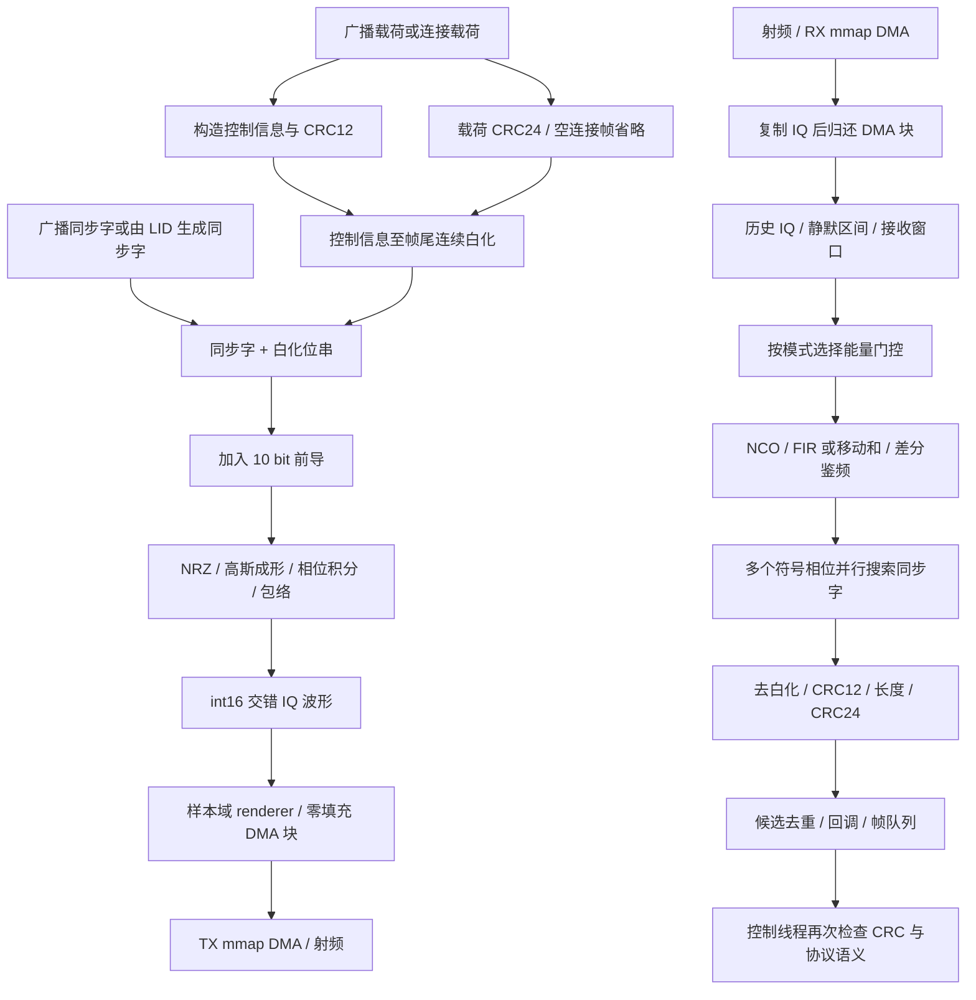
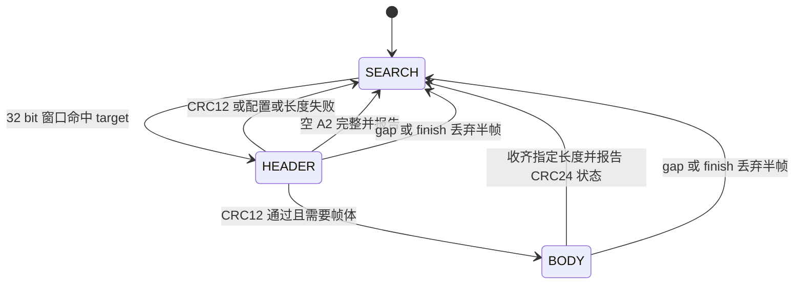
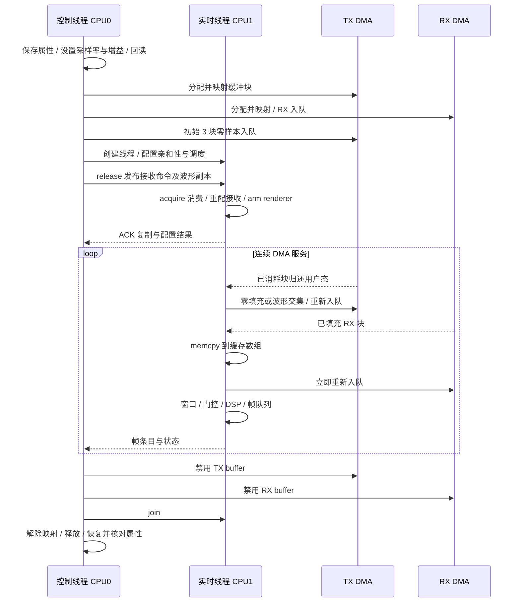

# 物理层实现：帧、GFSK、流式解调与 DMA 时序

本文面向修改发射波形、接收机、接入时序或设备数据路径的贡献者，说明公开源码中的位格式、调制解调、样点调度和 DMA 所有权。模块间关系见 [系统架构](architecture.md)，上层业务流程见 [协议栈](protocol-stack.md)。

工程为 `sle_gnode` / `sle_tnode` 实现 **1 Msym/s、高斯频移键控（GFSK）、A1 广播与 A2 连接帧子集**，并提供面向固定硬件和互通配置的调度策略。库函数能解析某个字段或接受某个参数，不等于应用已支持相应模式；下文分别列出库能力与运行入口限制。

算法与参数均以公开实现为依据，不代表完整标准或符合性认证。IQ 表示同相与正交分量，`sps` 表示每符号样点数；源码链接同时标明相关函数，便于定位。

## 1. 源码边界与信号链

位层、波形处理、样点调度和设备访问由不同模块负责。下表给出阅读入口，随后信号链图说明它们如何组合。

| 模块 | 责任与阅读入口 | 不由该模块完成的工作 |
| --- | --- | --- |
| [`sle_phy.h`](../sle-rt/sle_phy.h)、[`sle_phy.c`](../sle-rt/sle_phy.c) | 位数组、同步字、CRC、白化、A1/A2 编解码；`sle_encode_connect_config` | 前导、IQ、射频设置、加密与重传策略 |
| [`sle_gfsk.h`](../sle-rt/sle_gfsk.h)、[`sle_gfsk.c`](../sle-rt/sle_gfsk.c) | `sle_gfsk_default`、`sle_gfsk_with_preamble`、`sle_gfsk_mod` 通用波形生成 | 帧语义与 DMA 排队 |
| [`sle_t_wave.h`](../sle-rt/sle_t_wave.h)、[`sle_t_wave.c`](../sle-rt/sle_t_wave.c) | `sle_t_wave_init`、`sle_t_modulate` 固定参数快速调制 | 通用采样率、任意 BT 或频偏配置 |
| [`sle_demod.h`](../sle-rt/sle_demod.h)、[`sle_demod.c`](../sle-rt/sle_demod.c) | 数字下变频、滤波、鉴频、多相搜索、帧回调 | 自动发现连接配置、完整载波/时钟恢复 |
| [`sle_access.h`](../sle-rt/sle_access.h)、[`sle_access.c`](../sle-rt/sle_access.c) | 广播载荷、资源字、TLV、接入请求/响应编码 | 调制及设备运行 |
| [`sle_clock.h`](../sle-rt/sle_clock.h)、[`sle_clock.c`](../sle-rt/sle_clock.c) | 通道映射、时间换算、接入窗口、跳频与连接事件 | 硬件时钟同步、DMA 驱动 |
| [`sle_radio_core.h`](../sle-rt/sle_radio_core.h)、[`sle_radio_core.c`](../sle-rt/sle_radio_core.c) | 校准、样本域排程、波形渲染、能量门限、互通配置约束 | 访问设备、获取系统时间 |
| [`sle_radio.h`](../sle-rt/sle_radio.h)、[`sle_radio.c`](../sle-rt/sle_radio.c) | 控制/实时线程交接、DMA 服务、历史 IQ、接收窗口、恢复 | 通用多硬件适配层 |
| [`sle_iio.h`](../sle-rt/sle_iio.h)、[`sle_iio.c`](../sle-rt/sle_iio.c) | sysfs、mmap DMA 块 ABI、线程亲和性与实时策略 | libiio 抽象、自动设备枚举 |



图中的载荷对于物理层只是字节串：加密、密钥协商和上层封装发生在其他层。空连接帧也有 CRC12，但没有载荷和 CRC24。同步字与前导均不参与白化。

## 2. 参数：库能力、实时配置与应用限制

通用接口的参数范围大于实时路径使用的范围，应用缓冲区还会进一步限制可发送的帧长。

### 2.1 波形与接收参数

实时波形固定为 4 MS/s，接收配置则按扫描或有限窗口选择门控和滤波路径。

| 参数 | 库默认值或接口能力 | 当前实时路径 | 证据 |
| --- | --- | --- | --- |
| 符号率 | 固定 1 Msym/s，每个符号承载一个硬判决 bit | 同左 | [`sle_gfsk_mod`](../sle-rt/sle_gfsk.c#L33)、[`sle_demod_channel_init`](../sle-rt/sle_demod.c#L85) |
| 采样率 | 通用调制接受正整数 MHz，核长度限制到 32 MS/s；解调默认上限 16 MS/s，只接受近似整数 samples/symbol | `SLE_RT_FS = 4,000,000`，4 samples/symbol，250 ns/sample | [`sle_gfsk.c`](../sle-rt/sle_gfsk.c#L33)、[`sle_demod.h`](../sle-rt/sle_demod.h)、[`sle_radio_core.h`](../sle-rt/sle_radio_core.h#L11) |
| 峰值频偏 | `sle_gfsk_default` 为 250 kHz | 250 kHz；由此计算调制指数 `h = 2 × 250 kHz / 1 MHz = 0.5` | [`sle_gfsk_default`](../sle-rt/sle_gfsk.c#L10) |
| 高斯 BT | 默认 0.5，通用配置可改正值 | 0.5 | 同上；[`sle_t_wave_init`](../sle-rt/sle_t_wave.c#L9) |
| 高斯核 | `4 × sps + 1` 个归一化系数，支撑范围为 ±2 个符号 | 17 抽头 | [`sle_gfsk_mod`](../sle-rt/sle_gfsk.c#L33) |
| 前导 | 封装函数添加 10 bit，按发射顺序为 `0101010101` | 两个实时调制入口都添加一次 | [`sle_gfsk_with_preamble`](../sle-rt/sle_gfsk.c#L25)、[`sle_rt_modulate`](../sle-rt/sle_radio_core.c#L200) |
| 幅度 | 默认 8000，单位为 int16 数字幅值 | 8000；不能直接换算为天线口功率 | [`sle_gfsk_default`](../sle-rt/sle_gfsk.c#L10) |
| 首尾包络 | 默认各 `round(2 µs × fs)` samples | 各 8 samples，即各 2 µs | 同上 |
| 数字频移 | 通用调制的 `offset_hz`；解调 NCO 独立接受 `offset_hz` | RX 初始化为 0；`sle_rt_modulate` 允许有限值且绝对值不超过 200 kHz；快速 T 调制无频移参数 | [`sle_rt_modulate`](../sle-rt/sle_radio_core.c#L200)、[`sle_rt_radio_rx_configure`](../sle-rt/sle_radio.c#L223) |
| 接收 FIR | 初始化默认启用 63 抽头、Hamming 窗、700 kHz 截止的低通 | 所有实时模式显式旁路 FIR | [`sle_demod_channel_init`](../sle-rt/sle_demod.c#L85)、[`sle_rt_radio_rx_configure`](../sle-rt/sle_radio.c#L223) |
| 移动和 | 默认关闭；FIR 旁路时可设 2–8，0 表示关闭 | 连续广播扫描/校准关闭；其余接收模式设为 5 | [`sle_demod_set_boxcar`](../sle-rt/sle_demod.c#L129)、[`sle_radio.h`](../sle-rt/sle_radio.h#L17) |
| 多相去重 | 库默认关闭 | 显式开启 | [`sle_demod_set_dedup`](../sle-rt/sle_demod.c#L277)、[`sle_rt_radio_rx_configure`](../sle-rt/sle_radio.c#L223) |
| 同步容错 | 每个 target 指定最大位错误数 | 广播为 0；连接由 `SLE_RT_SYNC_ERRORS` 控制，默认 1 | [`sle_radio.h`](../sle-rt/sle_radio.h#L18)、[`sle_rt_radio_rx_configure`](../sle-rt/sle_radio.c#L223) |
| 射频基带带宽 | 不属于纯 DSP 库参数 | RX/TX sysfs 均写 1,750,000 Hz；初始 LO 均为 2424 MHz | [`sle_rt_radio_setup`](../sle-rt/sle_radio.c#L85) |

“接受 1–16 MS/s”只说明解调初始化的数值检查范围。例如 1 MS/s 时固定 700 kHz FIR 截止高于 Nyquist，不能据此称全部可接受采样率都是合理或经过射频验证的配置。实时路径还有按 4 MS/s 写定的样本换算；修改 `SLE_RT_FS` 不是完整的采样率移植。

应用默认值还要继续向调用者追踪：[`sle_gnode.c` 的 `opt`](../sle-rt/sle_gnode.c#L88) 采用 TX gain −30、RX gain 30，实时 CPU1/FIFO80、控制 CPU0/FIFO60，发送频偏默认 0；[`sle_tnode.c` 的 `opt`](../sle-rt/sle_tnode.c#L73) 采用 TX gain −10、RX gain 30。这里是传给设备属性的增益设置，不能把 TX gain 数值写成实测发射功率。G 的自动频偏估计为可选路径，默认配对路径对频偏选项另有限制，见 [`sle_gnode.c` 参数校验](../sle-rt/sle_gnode.c#L1488)。

### 2.2 四种不同的长度上限

帧字段能表示的长度、波形能容纳的样点数和应用允许排队的载荷长度各不相同。

| 所在层 | 当前边界 | 对贡献者的含义 |
| --- | --- | --- |
| A1 帧编码 | 载荷 0–255 bytes | 长度字段为 8 bit；零载荷仍有 CRC24 |
| 配置化 A2 帧编码/解码 | 非空载荷 1–2047 bytes；空帧另行表示 | 长度字段为 11 bit；`max_payload_bytes` 可进一步收紧，0 表示采用 2047 上限 |
| `sle_rt_wave` + 两个实时调制入口 | 4096 复样点；从同步字起的输入最多 **1010 bit** | 普通非空帧 `88 + 8L`，故物理层载荷最多 **115 bytes** |
| 应用自己的发送路径 | 可能进一步收紧 | 例如 G 的非缓存数据帧路径要求频偏为零且 `tx.len <= 96`；115 不是应用 MTU |

证据分别为 [`sle_phy.h` 常量](../sle-rt/sle_phy.h#L32)、[`sle_encode_connect_config`](../sle-rt/sle_phy.c#L354)、[`sle_rt_modulate`](../sle-rt/sle_radio_core.c#L200)、[`sle_t_modulate`](../sle-rt/sle_t_wave.c#L32)、[`sle_gnode.c` 非缓存发送检查](../sle-rt/sle_gnode.c#L1152)。

1010 的推导需要同时看两个容量：局部位数组先限制 `n <= 1014`，但实际波形长度为 `8 + (n + 10) × 4 + 8`，受 4096 samples 限制后只剩 `n <= 1010`。115 bytes 帧是 1008 bit，生成 4088 samples；116 bytes 已是 1016 bit。4096 samples 相当于 1.024 ms，但并不表示所有协议帧都能填满这个缓冲区。

编解码器的最大帧为 `32 + 32 + 2047 × 8 + 24 = 16464 bit`，使用一个 `uint8_t` 存一个 bit。解调器可流式接收这类长帧；不能因为实时 TX 缓冲区较短就把 RX 库能力也写成 115 bytes。

## 3. 位层：表示方式、同步字、CRC 与白化

位层先构造同步字和控制信息，再计算 CRC 并连续白化。位序、CRC 输出顺序和空帧规则决定了最终发射位串。

### 3.1 位数组与帧布局

`uint8_t bits[]` 是未打包的 0/1 数组，索引从小到大就是传输顺序。普通多位字段的最低有效位先发，载荷每个 byte 也是 LSB-first；**CRC 寄存器余数使用 MSB-first 输出**。不能用一句“所有字段都是 LSB-first”概括整个帧。对应函数为 [`sle_u32_to_bits_lsb` / `sle_bytes_to_bits_lsb`](../sle-rt/sle_phy.c#L59) 和 [`sle_crc_to_bits`](../sle-rt/sle_phy.c#L26)。

| 顺序 | 长度 | 处理 |
| --- | --- | --- |
| 前导 | 10 bit | 由调制 封装函数添加，不在 `sle_encode_*` 输出内，不白化 |
| 同步字 | 32 bit | 不白化；帧时间基准为其 bit 0 |
| 控制信息 | 20 bit | 字段 LSB-first；参与 CRC12；白化 |
| CRC12 | 12 bit | 余数 MSB-first；白化 |
| 载荷 | `8L` bit | byte 内 LSB-first；参与 CRC24；白化 |
| CRC24 | 24 bit | 余数 MSB-first；白化；空 A2 帧省略 |

下面偏移均相对 **20 bit 控制信息起点**，不包含同步字。

| A1 字段 | 偏移 | 位宽 |
| --- | --- | --- |
| `broadcast_type` | 0 | 3 |
| `packet_type` | 3 | 3 |
| `reserved` | 6 | 6 |
| `length` | 12 | 8 |

| A2 字段 | 偏移 | 位宽 |
| --- | --- | --- |
| `pkt_type` | 0 | 2 |
| `empty` | 2 | 1 |
| `sn` | 3 | 1 |
| `nesn` | 4 | 1 |
| `flow` | 5 | 1 |
| `mgmt_rx` | 6 | 1 |
| `reserved2` | 7 | 2 |
| `length` | 9 | 11 |

布局直接来自 [`sle_encode_broadcast`](../sle-rt/sle_phy.c#L172) 与 [`conn_info_bits`](../sle-rt/sle_phy.c#L286)。A1 从同步字起总长是 `88 + 8L` bit；A2 非空同样如此。A2 必须满足 `empty=1 && L=0` 或 `empty=0 && L>0`，空帧仅有 64 bit。

### 3.2 同步字不是随意配置的 32 bit 地址

广播同步字常量为 `0x5A2BDA62`，编码器按数值的 bit 0 到 bit 31 输出。连接同步字由 24 bit LID 经 [`sle_sync_from_lid`](../sle-rt/sle_phy.c#L117) 生成：

1. 将 LID 展开为 24 个 LSB-first bit，前置 `[1, 0]`，得到 26 bit `at`。
2. 对低次项在前的多项式表示，在 `at` 前补 5 个零，按 `G = 0045`（C 八进制，即 `0x25`）求 5 bit 余数。
3. 将 `at` 和余数拼成 31 bit，与 `mseq31` 输出逐位异或；第 32 bit 固定为 0。
4. `mseq31` 使用 5 个初始为 1 的寄存器，输出 `r[4]`，反馈为 `r[1] XOR r[4]`。

这里“前补零求余”和“将余数放在最终输出末尾”是两个不同步骤，移植时不要按直觉互换。全 1 的 24 bit LID 会生成广播同步字。反向的 [`sle_sync_check_window`](../sle-rt/sle_phy.c#L145) 做结构验证和 LID 恢复，不做纠错。

### 3.3 CRC 的计算域与移位方向

[`sle_crc_bits`](../sle-rt/sle_phy.c#L12) 对每个输入 bit 执行：取当前寄存器最高位与输入异或为 feedback，寄存器左移并限制宽度，feedback 为 1 时再异或 polynomial。函数没有额外的尾部补零步骤或 final XOR。多项式参数省略最高次项。

| CRC | 多项式参数 | 初始值 | 覆盖的数据 |
| --- | --- | --- | --- |
| CRC12 | `0x80F` | 同步字按 LSB 数值解释后的低 12 bit；广播为 `0xA62` | 20 bit 未白化控制信息 |
| A1 CRC24 | `0x65B` | `0x555555` | 未白化载荷位串；不含控制信息和 CRC12 |
| A2 CRC24 | `0x65B` | `config->crc_init & 0xFFFFFF` | 未白化载荷位串；不含控制信息和 CRC12 |

CRC 的输入顺序已经由位数组定义；不要在 `sle_crc_bits` 内再次反转每个 byte。`sle_crc_to_bits` 将余数从寄存器最高位写到最低位，再交给白化。连接 `crc_init` 的高 8 bit 被忽略，这是当前 CRC24 路径的行为，不表示支持 CRC32。

A1 零载荷仍计算并发送 CRC24；空 A2 不计算也不发送它。空 A2 解码输出 `has_crc24=0`、`crc24_ok=1`，后者是“不需要 CRC24 检查”的状态标记，不是收到一个有效的 CRC24 字段。完整有效性应理解为 `crc12_ok && (!has_crc24 || crc24_ok)`，还须满足具体调用者的字段和身份检查。

### 3.4 白化必须跨字段连续

[`sle_whitening_bits`](../sle-rt/sle_phy.c#L35) 和配置化连接编码内部的 [`whiten_step`](../sle-rt/sle_phy.c#L315) 使用 7 bit 状态。每一步先输出旧状态的 bit 6，再更新：

```text
output = (state >> 6) & 1
state  = ((state << 1) & 0x7F) XOR (output ? 0x11 : 0)
wire_bit = plain_bit XOR output
```

从控制信息第一个 bit 开始，一直经过 CRC12、载荷和 CRC24，**中途不重置状态**。去白化执行同样的异或。前导和同步字不消耗白化序列。

底层序列生成将 seed 限制到低 7 bit，允许 0；零 seed 会产生全零序列。配置化连接接口则拒绝 `white_seed > 127`。广播 seed 由调用者提供；接入封装使用物理通道编号，连接事件使用时隙推导值，详见第 6 节。不能把广播通道编号直接当作每一个连接事件的 seed。

### 3.5 正确选择编解码接口

[`sle_encode_connect_config`](../sle-rt/sle_phy.c#L354) / [`sle_decode_connect_config`](../sle-rt/sle_phy.c#L397) 是有完整连接上下文的入口。配置要求 LID 不超过 24 bit，seed 不超过 127，最大载荷不超过 2047。`crc_type` 枚举可表达 24/32，但当前 [`sle_connect_config_validate`](../sle-rt/sle_phy.c#L329) 对 32 返回 `SLE_DECODE_UNSUPPORTED_CRC`；即使要发空连接帧，也要使用支持的 CRC24 配置。

编码先检查指针、字段范围、空标志与长度关系、配置和输出容量，再写输出，失败返回 0。解码先验证配置与同步字，去白化并验证 CRC12，才信任长度并等待帧体。应区分 `NEED_MORE`、`CRC12_FAIL`、`CRC24_FAIL`、`BAD_CONFIG`、`BAD_LENGTH` 和 `UNSUPPORTED_CRC`，不能把它们统一记为“未发现信号”。CRC24 失败时载荷仍会填入输出结构，供诊断使用。

兼容入口有明显边界：[`sle_encode_connect`](../sle-rt/sle_phy.c#L303) 缺少必要连接上下文，当前始终返回 0；[`sle_decode_connect`](../sle-rt/sle_phy.c#L447) 枚举 0–127 seed，选第一个通过 CRC12 的候选，能处理空帧，非空返回 `NEED_CONFIG`。枚举得到一个 CRC12 命中不是自动恢复完整连接参数的保证。

广播原始编码函数没有容量参数，也不提供配置化连接入口那样完整的参数检查。接入调用优先使用 [`sle_access_encode_frame`](../sle-rt/sle_access.c#L526)：它检查输出容量、3 bit 类型和 seed 范围，并将 reserved 置零。不过其 `phys <= 127` 检查只是 seed 容量检查，不是实际 RF 通道有效性检查；真实物理通道还应通过 `sle_phys_to_mhz` 验证。

## 4. 发射波形：通用路径与 T 优化路径

通用调制器按配置计算高斯成形与相位；T 路径使用固定参数查表生成波形。两者共享帧边界约定，但数值结果不保证逐字节一致。

### 4.1 通用 GFSK 算法

[`sle_gfsk_mod`](../sle-rt/sle_gfsk.c#L33) 把 0/1 映射到 −1/+1，并在每个符号的 `sps` 个采样上保持不变。高斯核的标准差按实现为：

```text
sigma = sqrt(ln(2)) * sps / (2 * pi * BT)
tap[k] = exp(-0.5 * (k / sigma)^2),  k = -2*sps ... +2*sps
随后将所有 tap 除以总和
```

卷积采用居中的 same 形式；位串范围外的 NRZ 值为零。瞬时调制频率是归一化卷积输出乘以 `deviation_hz`。每个输出采样先累加调制相位，再输出 IQ：

```text
phase += 2*pi*frequency/fs
angle  = phase + 2*pi*offset_hz*n/fs
I[n] = round(amplitude * envelope[n] * cos(angle))
Q[n] = round(amplitude * envelope[n] * sin(angle))
```

因此相位积分与“先输出、后更新”的实现会差一个采样。首尾 ramp 使用半余弦包络，从零升起、最终降到零；ramp 区调制频率为零，但数字频移仍继续旋转相位。输出为 `int16_t` 交错 I/Q，一个 复样点 占 4 bytes；返回值和 `cap_samples` 都按 复样点 计数，不是 int16 元素数。

`lead + nbits*sps + tail` 只给出长度。[`sle_gfsk_len`](../sle-rt/sle_gfsk.c#L20) 不是参数验证器。原始调制配置还没有完整的有限值、幅值溢出与饱和保护；改幅度或接入不可信参数时，需要在调用层约束，不能假设转成 int16 会安全削顶。

### 4.2 `sle_t_modulate` 的查表生成与数值差异

[`sle_t_wave_init`](../sle-rt/sle_t_wave.c#L9) 为固定 4 MS/s、BT=0.5、250 kHz、幅度 8000 的波形预计算旋转系数。17 抽头 在当前采样率下涉及最多五个相邻符号，每个位置有零延拓、−1、+1 三种情况，因此有 `3^5 = 243` 种上下文，每种有四个符号内采样相位。

[`sle_t_modulate`](../sle-rt/sle_t_wave.c#L32) 通过查表和 float 复数递推生成 IQ，采用半值远离零的量化方式。它保持与通用路径相同的帧边界、前导和 ramp 约定，但浮点精度和累计误差使输出不保证逐字节相同。初始化的静态 `ready` 不是并发初始化保护，应在创建工作线程前完成一次初始化；初始化后调制使用局部状态。

两个实时封装 对 `n=0` 都能生成“只有前导和 ramp”的波形；这不构成可解码的协议帧。原始 `sle_gfsk_mod` 对零输入位数则直接拒绝。需要区别封装行为与底层行为。

[`test_sle_t_wave.c`](../tests/test_sle_t_wave.c) 以通用路径作参考，断言最大 IQ 差不超过 4 个整数单位，平坦包络区瞬时频率差小于 500 Hz，并覆盖临界长度和随机输入。这些是测试源码中的误差阈值，不是射频测量结果或 RF 误差规范。

## 5. 接收机：流式状态、多相判决与失败语义

接收机维护跨块的滤波与帧状态，在多个离散符号相位上搜索同步字。输入不连续、CRC 失败和重复候选分别处理。

### 5.1 DSP 顺序与时间补偿

[`sle_demod_channel_process`](../sle-rt/sle_demod.c#L402) 依次处理数控振荡器（NCO）频移、滤波、差分鉴频，再将硬判决位交给对应符号相位状态机。有限冲激响应（FIR）滤波器与移动和滤波是可选路径，实际选择见参数表。

- NCO 乘以 `exp(-j 2π offset_hz n/fs)`，每 4096 samples 重新归一化；零频移时直接旁路。
- 默认 FIR 是 63 抽头 的归一化 Hamming 窗 sinc，群时延按 31 samples 补偿，先消耗 63 samples 暖机。实时路径明确旁路它。
- boxcar 是复数 IQ 的**移动和**，没有除以窗口长度。长度 N 时暖机 N samples，索引延迟补偿取 `floor(N/2)`；实时 N=5 时为 2 samples。它须配合 FIR 旁路。
- 鉴频使用相邻复样本乘积 `y[n] * conj(y[n-1])` 的虚部符号；实现兼顾负实轴上的正零特殊情况，热循环不调用 `atan2`。这给出符号硬判决，没有软信息输出。

以上来自 [`sle_demod_channel_init`](../sle-rt/sle_demod.c#L85)、[`sle_demod_set_boxcar`](../sle-rt/sle_demod.c#L129) 和 [`sle_demod_channel_process`](../sle-rt/sle_demod.c#L402)。暖机后还需要前一个有效滤波样本才能计算差分。窗口应覆盖完整前导和足够的滤波上下文；从同步字中途开始喂数据无法凭后面的 CRC 恢复丢失前缀。

群时延补偿后的样本索引用于 `phase = aligned_index % sps`。4 MS/s 下有四个并行相位，每个相位每符号接收一个 bit；这是离散相位枚举，不是连续符号定时环路。回报的 `sample_index` 是经延迟补偿的同步起点估计，仍受离散相位与判决影响，不是实测 RF 边界的硬件时间戳。当前接收机没有重采样、AFC、载波跟踪、软判决或载荷 FEC。

### 5.2 每个相位的帧状态机

每个符号相位独立搜索同步字，先验证头部，再按长度接收帧体。缺口或流结束会丢弃尚未完成的帧。



[`phase_feed_bit`](../sle-rt/sle_demod.c#L323) 的 SEARCH 只匹配已添加 target 的同步字，默认最多 8 个 target。HEADER 在总计 64 bit 时调用位层解码；CRC12 通过后才进入 BODY，帧体长度不得超过 `SLE_MAX_FRAME_BITS`。同步匹配允许指定 Hamming 距离，但命中后会把候选缓冲区的前 32 bit **替换为 target 的正确同步字**。它只容忍同步字损伤，不纠正控制信息或载荷。

BODY 对完整 CRC 通过和 CRC24 失败都进行回调。`sle_radio.c` 的 [`on_frame`](../sle-rt/sle_radio.c#L201) 只先筛 CRC12，因此控制线程收到帧队列条目并不等于载荷有效；协议层必须继续检查 CRC24 和字段语义。

连接 target 应使用 [`sle_demod_add_connect_config_target`](../sle-rt/sle_demod.c#L189)。该函数复制配置，之后改变调用者原结构不会改变已安装 target。每次连接事件白化 seed 改变时，应重配 target；实时接收命令正是按事件构造独立配置。

### 5.3 去重、统计和弱候选

[`report_frame`](../sle-rt/sle_demod.c#L306) 与 [`dedup_flush`](../sle-rt/sle_demod.c#L287) 按同步时间邻近性分组：相差不超过一个 `sps` 的候选视为同组，优先保留完整 CRC 有效者，再选较早的同步样本。等待截止点约为当前对齐样本加 `sps+1`；`finish` 会刷出尚未交付的完整候选。

这种去重不比较载荷内容，不能当成协议重传去重。`sync_candidates`、CRC 失败和 `frames_ok` 等统计在相位候选层累加，`frames_ok` 也在去重之前计数。它们不是唯一空口包数，更不是可直接计算 PER 的发送/接收统计。

### 5.4 连续样本契约

输入样点索引决定是否延续状态。缺失区间会重置解调状态，过期或重叠输入则整块拒绝。

| 输入关系 | `sle_demod_channel_process` 行为 | 调用者需要理解的后果 |
| --- | --- | --- |
| 第一块非空输入 | 建立样本 origin | origin 可以非零，帧时间保持绝对输入索引 |
| 下一块起点等于期望索引 | 保留 NCO、滤波器、差分、各相位半帧 | 任意块切分不应改变解码结果 |
| 起点在期望索引之后 | 记录缺口，重置 DSP/半帧，接受新块并返回 GAP 状态 | 不能跨缺失样本拼帧 |
| 过期、重叠或回退 | 整块拒绝，不消费输入 | 不可以只当“重复块可忽略”继续推进本地计数 |
| 长度为 0 | 无操作 | 不隐式终结流 |
| 指针或索引范围非法 | 返回错误 | 不应解读为无信号 |

[`sle_demod_channel_finish`](../sle-rt/sle_demod.c#L240) 清除 DSP 状态和 origin，保留 target 与累计统计，记录被截断候选并刷出完整去重候选。它是显式分段边界，不只是一个“看看还有没有包”的查询。

### 5.5 实时门控、历史 IQ 与频偏估计

[`sle_rt_radio_rx_configure`](../sle-rt/sle_radio.c#L223) 仅在 `!connect && rx_end == INT64_MAX` 时启用能量门控。也就是说，连续广播扫描/校准可以省略安静数据；有限广播窗口和连接接收使用移动和并喂入窗口交集内全部样本。

[`sle_rt_energy_step`](../sle-rt/sle_radio_core.c#L12) 每隔 4 samples 取样，使用 128 samples 分箱峰值和安静功率下包络，默认功率因子 10（按功率比折算为 10 dB）。前 8 块学习阶段放行；门控保留热块前一块、当前块和后续保护块，并避免重复回放。这个因子不是 dBm 阈值，也不是自动增益控制。

[`sle_rt_radio_rx_block`](../sle-rt/sle_radio.c#L264) 要求块起点连续、对齐，先复制到 8192 复样点 的历史环，再做静默和窗口筛选。历史长度在 4 MS/s 下为 2.048 ms。静默期间会结束解调段并清理相关上下文；有意跳过安静块后，下一次喂入在解调流看来也是 GAP，不能将此统计直接等同于硬件丢样。

[`estimate_cfo`](../sle-rt/sle_radio.c#L183) 从完整有效的特定主广播帧同步字段估计载波频偏（CFO），取同步 bit 2–29 各两个差分相位样本，共 56 项，减去理想 ±250 kHz 分量。必须在命令中启用估计且历史 IQ 仍在；不可用时返回 NaN。它是依赖波形形状与定时的粗估计，并不会自动打开接收 NCO 纠偏。实际使用其结果的 G 应用路径还受默认配对策略和发送缓存约束。

## 6. 接入信息与协议时钟

接入解析器从广播载荷取得资源与连接参数，时钟模块将参数转换为信道、白化种子和事件时间。

### 6.1 广播载荷不是物理帧头

[`sle_bcast_pdu_parse`](../sle-rt/sle_access.c#L47) / [`sle_bcast_pdu_build`](../sle-rt/sle_access.c#L90) 处理 A1 **载荷内部**的公共 2 byte 头、可选标识、资源字和 TLV。present 位控制本地标识 6 bytes、IRK 字段 1 byte、对端标识 6 bytes、资源字 4 bytes 和后续数据的存在性。bit reader/writer 跨 byte 连续按 LSB-first 工作；多 byte 整数按小端组装。

TLV 的 type 和 length 各占 1 byte，length 只计 value；解析结构最多保留 8 个 TLV 引用，整个广播载荷仍受 255 bytes 限制。构建/解析还检查截断、容量和剩余数据。`sle_access_request_build` 使用 presence `0x15` 与 type `0x01`、`0x03` TLV，`sle_access_response_build` 使用 presence `0x11` 与 type `0x04`，分别见 [`请求构建`](../sle-rt/sle_access.c#L495) 和 [`响应构建`](../sle-rt/sle_access.c#L513)。这些值是当前封装的行为，不表示已实现所有可能的接入流程。

### 6.2 资源字布局必须显式选择

[`sle_resource_word_encode_layout`](../sle-rt/sle_access.c#L156) / [`sle_resource_word_decode_layout`](../sle-rt/sle_access.c#L176) 支持两种位置不同的 32 bit 布局。以下为数值 bit 位置：

| 字段 | `SLE_RESOURCE_LEGACY_WS63` | `SLE_RESOURCE_STANDARD` |
| --- | --- | --- |
| channel | 0–7 | 0–7 |
| offset unit | 8 | 31 |
| offset | 9–20 | 8–19 |
| frame type | 21–24 | 20–23 |
| bandwidth | 25–26 | 24–25 |
| pilot | 27–28 | 26–27 |
| accuracy | 29–31 | 28–30 |

不带布局参数的 `sle_resource_word_encode/decode` 封装固定使用 `LEGACY_WS63`，而当前 G/T 应用默认都选 `SLE_RESOURCE_STANDARD`，可选 `LEGACY_WS63`。枚举名本身不构成标准一致性证明。[`sle_rt_primary_layout`](../sle-rt/sle_radio_core.c#L98) 先按调用者选择的布局解析，再重新编码为 `sle_access_plan` 接受的 `LEGACY_WS63` 数值形式；不能跳过转换，直接传入 `STANDARD` 原始资源字。

资源偏移单位通过 [`sle_resource_word_offset_us`](../sle-rt/sle_access.c#L204) 换算为 125 µs 或 1250 µs。接入窗口长度由 [`sle_access_window_len_us`](../sle-rt/sle_access.c#L267) 给出：

```text
window_us = floor((rsp_offset_us - req_offset_us - 125) / count)
```

无效组合返回 0。[`sle_access_plan`](../sle-rt/sle_clock.c#L49) 检查通道、请求类型、非零窗口、请求长度和空口时长；根据配置选择仅第一窗口或允许后续窗口。辅助帧同步时间优先采用观测值，否则由主广播同步时间、资源偏移及显式 correction 计算。

实时主广播策略更窄：`sle_rt_primary_layout` 只接受 2424 MHz、seed 77 的指定主广播类型，并要求资源 frame type、bandwidth、pilot 为零、数据通道小于 76。它内建 request offset 2500 µs、response offset 6250 µs、一个窗口、请求 84 bytes、辅助时间 correction +25 µs 等互通配置。**这些是该函数的配置假设，不是从每个主广播自动协商得出，也不是通用空口常数。**

### 6.3 通道编号、频率与白化 seed

[`sle_phys_to_rf`](../sle-rt/sle_clock.c#L6) / [`sle_phys_to_mhz`](../sle-rt/sle_clock.c#L23) 区分“物理通道编号”与“RF 索引”：

| 物理编号 | RF 索引 | 频率 |
| --- | --- | --- |
| 76 | 0 | 2402 MHz |
| 77 | 22 | 2424 MHz |
| 78 | 78 | 2480 MHz |
| 0–20 | `phys + 1` | `2402 + RF` MHz |
| 21–75 | `phys + 2` | `2402 + RF` MHz |

数据跳频使用 0–75 共 76 个物理通道，但 hop map 的 bit 下标是 **RF 索引**。[`sle_hop_map_used`](../sle-rt/sle_clock.c#L123) 扫描数据通道并经映射查询相应 bit，不能把 map 当成直接以数据通道编号索引的数组。

传输指示解析器接受 60 bytes（10 byte map）和 75 bytes（25 byte map）两种长度，见 [`sle_tx_indication_parse`](../sle-rt/sle_access.c#L289)；连接调度器明确要求 map 长度为 10。因此不能从 25 byte map 的解析分支宣称当前运行时支持 5 GHz。

### 6.4 事件时间、跳频与第二发送方

[`sle_conn_sched_init`](../sle-rt/sle_clock.c#L133) 要求非零 `group_period_slots`、有效 slot 编码和至少一个启用的数据通道。`sle_sched_slot_us` 将编码 0–4 映射到 25、50、75、100、125 µs，其他编码返回 0。当前调度基于首个 LID 和事件组周期，不实现传输指示所能描述的全部多事件组合。

[`sle_conn_event`](../sle-rt/sle_clock.c#L151) 按以下关系给出事件 k：

```text
t0       = anchor_sync_ns + start_offset_us * 1000
t(k)     = t0 + k * period_slots * slot_ns
slot(k)  = (base_slot + k * period_slots) & 0x3FFFFFFF
seed(k)  = 0x40 | (slot(k) & 0x3F)
```

[`sle_hop_prng`](../sle-rt/sle_clock.c#L105) 先把同步字高低 16 bit 异或为 `p2`，以 slot 低 16 bit 异或 `p2` 初始化；进行三轮“每个 byte 内 bit 反转，再做 16 bit 的 `x = x*17+p2`”，最后异或 `p2`。[`sle_hop_channel`](../sle-rt/sle_clock.c#L114) 先试 `r % 76`，若该通道未启用则使用 `used[(r * n_used) >> 16]`。

所有帧时间均指 **同步字 bit 0**。[`sle_frame_air_ns`](../sle-rt/sle_clock.c#L42) 的空口时长却包含 10 µs 前导、不含首尾 ramp：空 A2 为 74 µs，其他帧为 `98 + 8L` µs。计划的 `req_tx_start_ns` 表示前导起点，比同步字早 10 µs，仍不是 IQ 缓冲区起点。

[`sle_second_sender_offset_ns`](../sle-rt/sle_clock.c#L169) 把“前一帧空口时长 + intra-event gap”向上取整到 slot 网格。实时 [`sle_rt_reply_matches`](../sle-rt/sle_radio_core.c#L260) 对预期回复还应用 −3 µs 的配置修正和默认 ±40 µs 匹配容差；不要将其合并进通用 airtime 函数或当作所有对端的固有行为。

## 7. 从协议时间到 DMA 样本时间

协议时间、RX/TX 样点计数和系统单调时钟各有用途。发送位置通过 RX/TX 偏移校准换算，不能直接由系统时钟或队列 ACK 推定。

### 7.1 三个时间域需要明确区分

调度以协议锚点为起点，执行以样点计数为依据，系统单调时钟只辅助期限和滞后检查。

| 时间域 | 来源 | 用途与限制 |
| --- | --- | --- |
| 协议纳秒时间 | 调用者提供的 anchor、slot 与偏移 | `sle_clock` 做整数计算，不负责同步物理时钟 |
| RX/TX 样本计数 | 实时线程按连续 DMA 块推进 | 同一方向内排程；两方向原点需校准 |
| `CLOCK_MONOTONIC` | [`sle_iio_now_ns`](../sle-rt/sle_iio.c#L169) | 截止时间、耗时和滞后诊断；不是 RF 帧硬件时间戳 |

[`sle_samples_to_ns`](../sle-rt/sle_clock.c#L29) 用商和余数分开换算以降低乘法溢出风险；[`sle_ns_to_samples`](../sle-rt/sle_clock.c#L36) 为正时间加半个采样的舍入项。它们没有完整处理所有 int64 极限或任意负时间的对称舍入，且采样率必须非零。当前运行时使用非负样本计数、4 MS/s；新调用者应自行验证输入边界。

虽然 IIO block 结构有 `timestamp` 字段，当前实时循环并不使用它建立时间轴。软件按每块固定样本数推进，不能由“计数连续”反推出硬件从未丢样或 RX/TX 时钟完全无漂移。

### 7.2 校准与波形起点

[`sle_rt_cal_observe`](../sle-rt/sle_radio_core.c#L177) 用已知 TX 同步位置与接收到的同步位置计算：

```text
offset = rx_sync - tx_sync
```

绝对 offset 超过 `SLE_RT_FS/5`（4 MS/s 下 200 ms）时拒绝并清除。后续观测与**第一次保留的 offset** 相差超过 8 samples（2 µs）则清除并返回跳变。累计 3 次一致观测才有效；它不取平均，不估计漂移速率。新鲜度由 [`sle_rt_cal_fresh`](../sle-rt/sle_radio_core.c#L190) 按调用者给定 TTL 检查，没有全局统一的库默认 TTL。

[`sle_rt_sync_in_wave`](../sle-rt/sle_radio_core.c#L195) 返回：

```text
lead ramp 8 samples + preamble 10 * 4 samples = 48 samples = 12 µs
```

因此 [`sle_rt_tx_index`](../sle-rt/sle_radio_core.c#L225) 使用：

```text
wave_start = desired_rx_sync - calibrated_offset - 48
```

若 `wave_start < tx_head`，返回迟到而不试发残帧。`tx_head` 是软件已经排入未来 TX 流的末端，不是“当前天线正在发送的样本位置”。将队列 ACK、已入队末端或系统时间直接当成 RF 发送完成时刻，都会破坏这里的推导。

### 7.3 默认块尺寸、保留深度与提前量

DMA 分配块数给出容量上限，实际预排深度决定还能多早插入波形；二者不能混用。

| 项目 | 默认数值 | 4 MS/s 下的换算或约束 |
| --- | --- | --- |
| `SLE_RT_BLOCK` | 1024 复样点 | 256 µs、4096 bytes |
| `SLE_RT_TX_BUFFERS` | 16 | 分配缓冲块数，是深度上限，不等于始终排队 16 块 |
| RX DMA 缓冲块数 | 16 | 由 `sle_rt_radio_start` 分配 |
| `SLE_RT_ACCESS_DEPTH` | 3 | 768 µs TX 保留量 |
| `SLE_RT_CAL_DEPTH` | 6 | 1.536 ms 校准阶段保留量，应用可用校准深度选项调整 |
| G/T 后续路径的深度 | `16*1024/SLE_RT_BLOCK` | 默认 16 块、4.096 ms；并非全过程都用 3 块 |
| `SLE_RT_TX_GUARD` | `BLOCK/2` | 默认 512 samples、128 µs |
| RX 历史 | 8192 复样点 | 2.048 ms，须容纳至少两块且整除块尺寸 |
| 接收帧环 | 64 条存储槽 | 单生产者/单消费者原子交接，满时需处理错误 |

常量见 [`sle_radio_core.h`](../sle-rt/sle_radio_core.h#L11)、[`sle_radio.h`](../sle-rt/sle_radio.h#L14)，分配见 [`sle_rt_radio_start`](../sle-rt/sle_radio.c#L456)，应用深度调整见 [`sle_gnode.c`](../sle-rt/sle_gnode.c#L1299) 和 [`sle_tnode.c`](../sle-rt/sle_tnode.c#L235)。头文件允许块尺寸为 256–4096、128 的倍数，但历史环整除断言、应用排队策略和测试中的固定块假设会进一步限制可用组合；改宏不等于完成验证。

[`sle_rt_access_lead`](../sle-rt/sle_radio_core.c#L42) / [`sle_rt_access_response_lead`](../sle-rt/sle_radio_core.c#L47) 把 retune、命令 ACK、settle、队列保留和 guard 变成接入准入预算。默认 retune 预算 RX/TX 各 2300 µs，ACK 512 µs，settle 100 µs。默认块配置下，前者为 12792 samples（3198 µs），后者在需要 TX retune 时为 22072 samples（5518 µs）、否则为 12872 samples（3218 µs）。这是代码计算的提前量，不是 Linux 调度延迟上界；每一步仍需检查真实截止时间。

### 7.4 renderer 的安全边界

[`sle_rt_render_arm`](../sle-rt/sle_radio_core.c#L233) 拷贝一个完整、不可变的波形，只允许一个活动任务。[`sle_rt_render_block`](../sle-rt/sle_radio_core.c#L242) 每次先将输出 DMA 块清零，再复制该块与计划波形的交集。因此空闲 TX 仍有连续零样本，不需要在每个包之间开关 DMA。

renderer 要求块起点严格按预期推进。如果在波形尚未完整输出时发生迟到或块不连续，会取消任务，不把已经错过的前缀丢掉后继续发后半帧。调用者不能提交重叠波形，也不能把该接口当成多包调度队列。

## 8. IIO DMA、线程所有权与生命周期

控制线程配置设备和管理生命周期，实时线程推进 DMA 与 DSP。缓冲区在内核和用户态之间交接，映射仍有效不代表用户态仍拥有访问权。

### 8.1 固定驱动接口与缓冲区所有权

[`sle_iio_open`](../sle-rt/sle_iio.c#L76) 使用设备文件和驱动的 block ioctl：allocate/query/enqueue/dequeue/free，配合 `mmap` 映射块。它不是 libiio，也不通过普通 `read()` 读取样本。当前头文件固定 PHY、TX、RX 的设备路径，分别对应 device0、device2、device3；这是当前设备适配假设，不是自动枚举算法。低层最多支持 32 块，运行时各用 16 块。

RX 在初始化映射后立即入队供设备填充；TX 初始由用户态持有，填好后才交给设备。低层 [`sle_iio_get`](../sle-rt/sle_iio.c#L101) 用 poll 等待可出队块，非阻塞无数据与其他错误有不同返回值；运行时另有私有 [`dequeue`](../sle-rt/sle_radio.c#L157)，验证 block ID、映射存在性和 `bytes_used == SLE_RT_BLOCK*4`。部分初始化失败仍要走清理路径，不能因为 `open` 返回错误就假设没有资源需要回收。



图强调所有权顺序，不将 ACK 画成空口完成信号。具体启动的 buffer enable 顺序为 TX 后 RX，见 [`sle_rt_radio_start`](../sle-rt/sle_radio.c#L456)。

### 8.2 热循环与交接

[`stream`](../sle-rt/sle_radio.c#L403) 负责补充 TX 并服务 RX。收到 RX 后先一次性复制到缓存数组，再归还 DMA 块，之后运行 DSP；不在映射 DMA 内存上逐采样做整条解调链，以缩短设备块占用时间。

控制线程拥有 sysfs 和生命周期，并在启动前完成初始零样本入队；进入流循环后，实时线程独占 DMA、DSP 与 renderer。[`sle_rt_radio_submit`](../sle-rt/sle_radio.c#L524) 使用单个待处理邮箱，按值复制命令和波形，通过 release/acquire 交接；[`command`](../sle-rt/sle_radio.c#L348) 消费后 ACK。ACK 只表示命令已被复制/配置，renderer 保留自己的波形副本；它不证明发射完成或对端接收成功。

提交和消费两侧都会检查 RX 窗口是否已过期。还可能遇到邮箱忙、renderer 忙或 TX 起点已经迟到。调用者必须同时处理同步返回值、ACK 结果和后续运行时错误，不能只等待 `ack_seq` 变化。

启动会检查关键原子操作是否 lock-free；停止信号在创建实时线程时被屏蔽并由控制侧接收。[`sle_iio_realtime`](../sle-rt/sle_iio.c#L153) 设置 CPU 亲和性、可选 `SCHED_FIFO` 和 `mlockall`；失败通过线程启动错误返回，不能默默把普通调度当成已经满足实时条件。

### 8.3 错误检测的含义与局限

无 RX 数据时热循环短暂休息 50 µs；100 ms 没有进展会报 stall。RX 滞后诊断比较单调时钟与样本推进速度，guard 开启且相对滞后超过 3 ms 时终止；下包络基线在运行中更新，以避免长期 ppm 差异被简单累计成滞后。实现见 [`stream`](../sle-rt/sle_radio.c#L403)。这些是软件健康检查，不能取代硬件 overflow/underflow 证据或独立空口验证。

guard 开启时，TX 队列全部排空被视为 underflow 并终止；校准等 guard 关闭阶段允许记录排空后继续。后一种情况不能用来证明持续 TX 时序已经有效。

提交与消费侧各有容量 16 的时序故障记录，保存单调时间、RX/TX head、计划起点、窗口和队列状态。[`sle_rt_radio_timing_write`](../sle-rt/sle_radio.c#L318) 只允许在 stop/join 后格式化输出，避免在实时线程进行日志 I/O。环覆盖较旧故障时保留总计和覆盖数量，诊断时不要将最终 16 条误认为全部故障。

### 8.4 停止和恢复也是实现的一部分

[`sle_rt_radio_setup`](../sle-rt/sle_radio.c#L85) 保存有限集合的设备属性，发现 RX 或 TX buffer 已启用会拒绝接管；采样率写入后必须读回确认。它把 RX 设为手动增益、开启 I/Q 扫描元素并关闭其他扫描元素。

[`sle_rt_radio_stop`](../sle-rt/sle_radio.c#L499) **先禁用设备 buffers，再 join 实时线程**，最后解除映射、释放队列并清除 renderer/mailbox。调换为“先无限等待线程退出再停 DMA”会改变错误和关闭路径。

[`sle_rt_radio_restore`](../sle-rt/sle_radio.c#L126) 在低层恢复基础上按顺序重写相关联的属性并回读比较；数字形式允许等值，自动增益模式下的瞬时增益值有例外处理。底层 `sle_iio_restore_all` 返回 void，不能单独用它声称已经验证恢复成功；应检查 radio 层恢复返回值。

## 9. 测试对应关系与证据强度

下表列出测试源码中的主要断言及其边界。离线测试检查位串、数值输出和软件状态；射频性能、驱动行为与实际互通需要对应的硬件验证。

| 测试文件与入口 | 源码中的检查重点 | 不能据此证明什么 |
| --- | --- | --- |
| [`test_sle_phy.c`](../tests/test_sle_phy.c)：`test_broadcast_encode`、`test_connect_config` | A1 长度 0/1/2/255、多 seed、截断和翻位；A2 空帧及 1/255/256/2047 bytes、2048 拒绝、字段/容量错误、错误 LID/seed/CRC、CRC32 拒绝、CRC init 高位忽略 | 同一库 encode/decode 往返可能共享错误；不是独立标准向量验证 |
| [`test_sle_gfsk.c`](../tests/test_sle_gfsk.c)：`roundtrip` | 4 MS/s 的 FIR 开/关；6 MS/s 加 1 MHz 数字频移；合成波形回解、去重和同步位置 | 不代表所有接受采样率、任意邻道或真实射频都可用 |
| [`test_sle_demod.c`](../tests/test_sle_demod.c)：`test_chunking`、`test_faults`、`test_crc_diagnostics` | 整块与 1/7/997/随机块切分等价，非零 origin，gap/过期块/finish/溢出；CRC12 丢弃与 CRC24 失败回调；窗口截断、配置化连接、2047 bytes 流式接收 | 合成噪声和频偏场景不能转成 RF 灵敏度、长期漂移或 PER 指标 |
| [`test_sle_access.c`](../tests/test_sle_access.c)：`test_resource_layouts` | 两种资源字布局、非对称参数、上限与非法字段/枚举 | 当前此文件没有覆盖全部 TLV/接入 PDU 路径 |
| [`test_sle_t_wave.c`](../tests/test_sle_t_wave.c) | 固定及随机 pattern，0–1015 bit 若干边界，快速/参考 IQ 和瞬时频率误差，载荷往返 | 测试中的调用计时不是板上吞吐基准；参考与被测实现也不是独立 RF 实现 |
| [`test_sle_radio_core.c`](../tests/test_sle_radio_core.c)：`protocol`、`scheduling`、`queues`、`waveform`、`gate_edges`、`gated_waveforms` | 配置/身份/CRC/窗口与提前量，三次校准/TTL/跳变，渲染跨块/迟到/取消，队列，门控极值/历史环回绕/大样本索引，有限窗口弱帧与静默复位 | 不访问真实 DMA 或验证射频互通 |
| [`test_sle_radio.c`](../tests/test_sle_radio.c)：`timing_diagnostics`、`concurrent_ring`、`main` | mock DMA 的错误 ID/短块/排空/入队失败/stall/RX lag，启动线程错误和清理，邮箱/波形副本所有权，三类迟到诊断与环覆盖，信号/停止/属性恢复，10 万条并发帧环交接 | mock 不能证明实际内核 ABI、驱动性能、设备恢复和物理时序 |
| [`test_sle_link.c`](../tests/test_sle_link.c) | 上层使用连接事件、时钟与链路状态的组合场景 | 不等于对 `sle_clock` 每个溢出、负数边界都有穷尽测试 |

当前没有独立的 `test_sle_clock.c` 或专门覆盖真实 IIO 驱动的 host 测试文件；时钟主要由 radio core/link 测试间接覆盖，IIO 硬件行为仍需要另外验证。默认解调 NEON FIR 开关为 0；[`sle-rt/Makefile`](../sle-rt/Makefile) 单独提供显式启用 NEON 的 ARM 解调测试目标。仅给编译器传 NEON 架构选项，不会自动让默认构建启用这条 FIR 路径。

## 10. 实现耦合与边界

各层参数相互约束。修改一个局部参数时，下表中的相关条件也会改变，单个编解码往返成功不足以证明整条路径可用。

| 变化点 | 关联约束 |
| --- | --- |
| 帧字段、CRC 或载荷长度 | 空/非空规则、白化连续性、CRC 输出位序、错误状态，以及解调缓冲区、波形容量和应用上限 |
| 采样率或滤波 | 每符号样点数、核长度、暖机、群时延、同步索引、48 样点起点换算、DMA 时长，以及固定为 4 MS/s 的计算 |
| 查表波形生成 | 前导只添加一次、零延拓、相位累加顺序、临界容量、调用间状态隔离及 IQ/相位误差 |
| 窗口或能量门控 | 前一块回放、重复输入、历史环回绕、静默后重置和完整前导；门控造成的 GAP 与 DMA 丢样含义不同 |
| 校准或调度 | 同步字、前导与包络起点的区别，偏移新鲜度、迟到拒绝和单波形所有权；固定偏移校准不补偿漂移速率 |
| DMA 生命周期或缓冲深度 | 复制后归还、禁用缓冲后 join/释放、单生产者/单消费者交接、故障退出及提交提前量 |
| 对端互通配置 | 资源布局、辅助时间修正、窗口参数和回复修正；解析器接受的字段范围可能大于调度器和应用可用范围 |

通用调制器对 NaN 和幅值溢出的防护不完整，调用者需要约束输入；时间换算也不是覆盖任意有符号极限值的通用数学接口。接收机使用硬判决与离散相位枚举，粗频偏估计没有形成自动纠偏闭环。软件样点计数连续和模拟 DMA 测试通过，都不足以证明硬件没有丢样。
