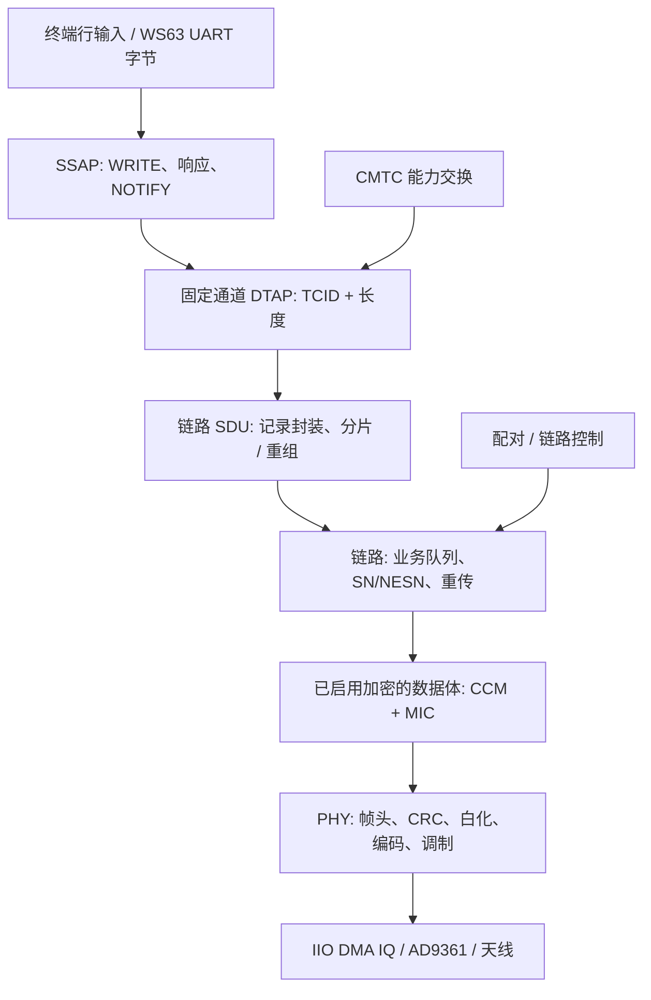
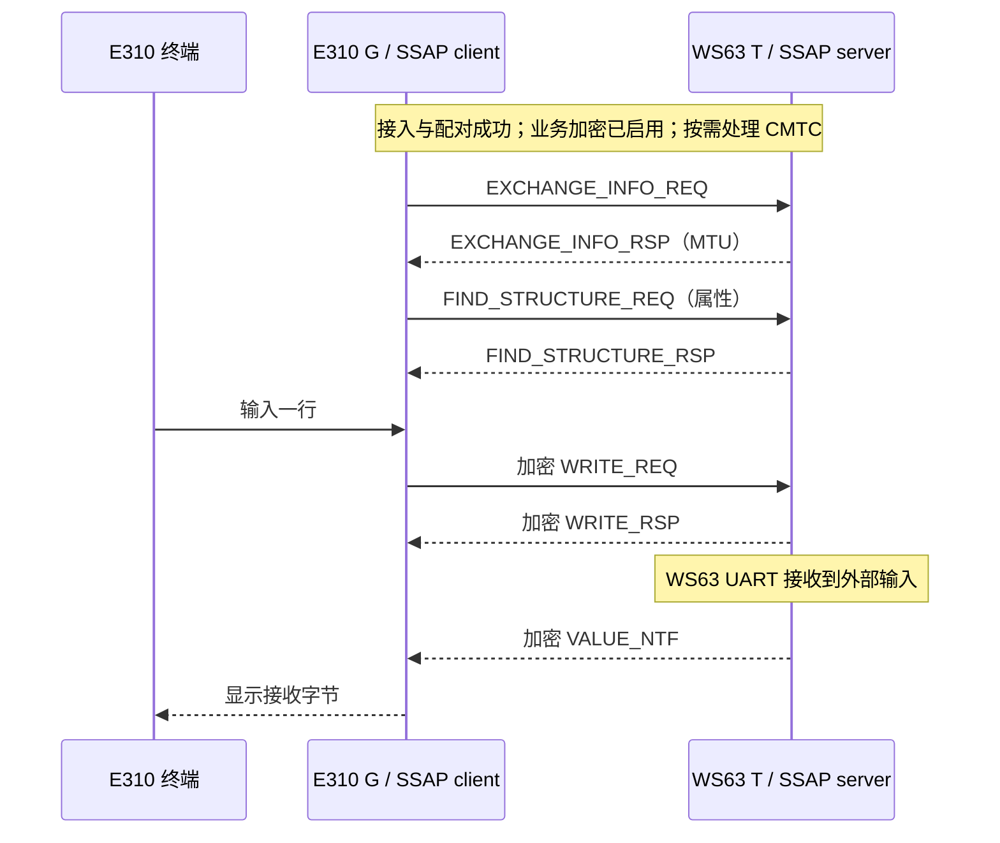
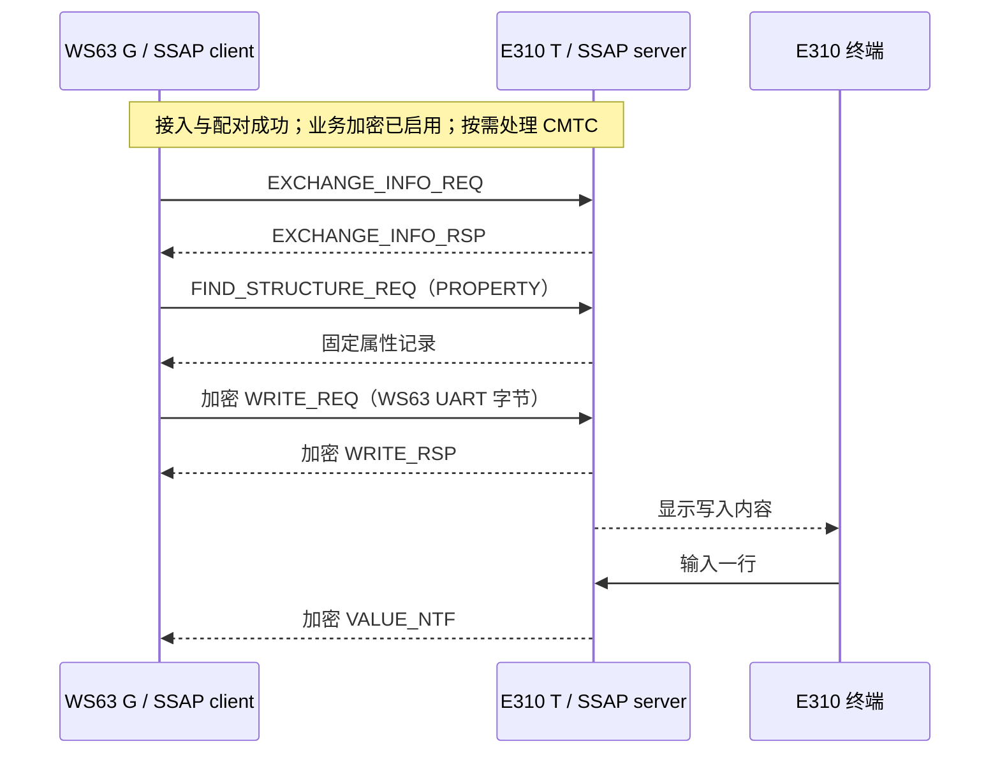

# SLE 协议栈与双向业务流程

本文面向需要理解双角色业务流程的开发者，说明本工程与 WS63 官方 SDK 1.10.108 示例互通所用的 SLE 协议子集。字段和状态转换以公开编解码器、状态机及测试源码为依据，不代表完整标准。模块分工见 [系统架构](architecture.md)，信号处理和密码学细节分别见 [物理层](physical-layer.md)、[配对与加密](security.md)。

## 1. 本工程的协议范围与角色

本工程在 E310 的 ARM/Linux 用户态实现 SLE 波形、接入、连接、配对和有限的 SSAP 业务，通过 AD9361 与外部 WS63 对端通信。WS63 运行独立固件，不属于 E310 程序；运行所需的对端配置见 [WS63 构建说明](ws63-build.md)。

四组角色必须分开理解：

| 角色或动作 | 在本项目中的意义 | 不应混同的概念 |
| --- | --- | --- |
| G / T | 连接资源、事件时序、链路收发的角色 | SSAP client / server |
| 发现广播方 / 扫描方 | 连接之前的可发现性与搜寻行为 | 永久的发送方 / 接收方 |
| SSAP client / server | 业务请求发起者 / 服务属性提供者 | 所有空口帧的发送方向 |
| WRITE / NOTIFY | client 写属性 / server 主动通知属性值 | 两种不同的加密算法 |

两个入口采用固定角色组合：`sle_gnode` 为 G + SSAP client，对接 WS63 server；`sle_tnode` 为 T + SSAP server，对接 WS63 client。它们均能双向传输，不能由此推导“所有 G 必须是 SSAP client”。依据：[G 程序](../sle-rt/sle_gnode.c)、[T 程序](../sle-rt/sle_tnode.c)、[server 状态机](../sle-rt/sle_ssap_server.c)。

本文常用缩写按本工程的处理边界理解：

| 名称 | 含义 |
| --- | --- |
| PHY | 物理层，负责位串、IQ 波形及接收判决 |
| PDU / SDU | 当前层处理的协议数据单元 / 当前层为上层承载的数据单元；同一串字节在不同层有不同称呼 |
| ARQ | 通过确认与重传提供可靠交付；当前链路用 SN / NESN 管理 |
| DTAP / TCID | 数据传输与适配封装 / 用于通道分发的标识，当前仅使用固定通道子集 |
| SSAP | 服务与业务属性访问层；本工程使用协商、发现、写入与通知 |
| CMTC | 本工程中处理传输管理能力交换的固定控制通道 |
| CRC / MIC | 传输差错检查 / 密码学完整性标签，两者用途不同 |
| MTU | 本文特指协商的 SSAP PDU 长度边界，不等于 UART 行长或单个空口帧载荷 |

下文按这些处理边界说明数据封装和状态转换。

## 2. 从终端字符到空口帧

下面是工程的软件职责分层图；箭头表示业务数据经过的处理，不代表标准文档中所有功能实体的完整组织关系。



不同控制信息的入口不完全相同：CMTC 使用自己的固定 DTAP 通道；配对及连接控制 PDU 由链路控制路径处理，不是 SSAP 属性写入。实际发送还需要调度器给出当前事件、信道、白化种子和发送时刻。实现入口为 [sle_cmtc.c](../sle-rt/sle_cmtc.c)、[sle_link.c](../sle-rt/sle_link.c)、[sle_g_runtime.c](../sle-rt/sle_g_runtime.c)、[sle_t_runtime.c](../sle-rt/sle_t_runtime.c)。

接收顺序同样重要：解调并校验 CRC → 对受保护帧校验 MIC / 解密 → 更新链路 ARQ、过滤重复 → SDU 重组 → 通道分发 → SSAP。CRC 只能发现传输差错；不能代替密码学认证。要求受保护的业务数据在认证失败时，以及已识别的重复数据，都不能进入 SDU 重组器，否则可能重复执行 WRITE 或破坏分片状态。配对前控制信息及下文所述 CMTC 明文例外按各自状态规则处理，不能据此把所有收包路径概括为必须先有 MIC。见 runtime 中的收包处理及 [sle_sdu.h](../sle-rt/sle_sdu.h) 的调用约定。

## 3. 发现与接入

广播提供身份和接入资源，接入请求与响应建立连接参数；调度器再把这些参数转换为连接事件。

### 3.1 广播携带什么

[sle_access.h](../sle-rt/sle_access.h) / [sle_access.c](../sle-rt/sle_access.c) 负责 A1 接入帧体。工程可编解码主广播、辅助广播、查询请求 / 响应、接入请求 / 响应。通用广播结构用 presence 标志指示本机标识、隐私相关标识、对端标识、资源信息和数据是否存在；当前结构中的设备标识为 6 字节，以空口字节序保存。

广播数据中的 TLV 承载发现 / 接入配置、传输指示、接入基本信息和请求 / 响应参数。这里的 TLV 数组容量是本地实现限制，不是协议允许的全局最大值。解析器不仅要看到类型字段，还必须检查长度和剩余字节，避免把截断帧解释成有效配置。资源字布局及范围检查的单元覆盖见 [test_sle_access.c](../tests/test_sle_access.c)；该文件不覆盖全部 TLV 和接入流程。

### 3.2 资源字段的两种布局

[sle_access.h](../sle-rt/sle_access.h) 和 [sle_access.c](../sle-rt/sle_access.c) 显式区分资源字的 `STANDARD` 与 `LEGACY_WS63` 布局。G/T 应用默认选择前者：offset 位于 bit 8–19，单位选择位于 bit 31；后者把单位放在 bit 8、offset 放在 bit 9–20。同一个 32 位数值在两种布局下含义不同，调用者须明确选择布局。

布局选项表示编码与解析能力，不代表所有对端配置均已互通。其余字段位置见 [物理层的资源字说明](physical-layer.md)，默认运行参数见 [互通说明](interoperability.md)。

### 3.3 从接入参数建立事件表

接入协商给出连接标识、周期、参考时隙、偏移、信道集合和超时等参数。[sle_clock.h](../sle-rt/sle_clock.h) 中的 `sle_conn_sched_t` 将其转成运行时调度状态；`sle_conn_event()` 为第 k 个连接事件计算时刻、时隙、物理信道、频率与白化种子。同步字由连接标识经 `sle_sync32_from_lid()` 派生；跳频通过 `sle_hop_prng()`、`sle_hop_channel()` 与可用信道映射完成。

调度锚点对应携带传输指示的帧的同步起点，不应误用收到最后一个字节或应用日志打印的时刻。事件已过期时跳过，不能延迟发送后仍把它当成原定时隙。T 默认使用预测回复，在收到当前 G 帧前预排波形；即使该事件未收到 G 帧，也不会取消已排出的发送。另有先接收、后回复的分支，其延迟和限制见 [架构中的 T 回复路径](architecture.md#42-t广播被接入两种回复路径)。第二发送方偏移等实现假设见 [sle_clock.c](../sle-rt/sle_clock.c) 注释及 [物理层时序章节](physical-layer.md)。

## 4. 连接与可靠交付

链路层管理未确认 PDU、重传和控制消息。它确认的是链路交付，业务是否成功还要由 SSAP 响应或对端输出判断。

### 4.1 SN / NESN 的最小状态机

[sle_link.c](../sle-rt/sle_link.c) 的 `sle_arq_rx()` 使用一位 SN / NESN 维护当前发送与下一期望接收状态：

- 本端有待确认 PDU，且收到的对端 NESN 与本端 `tx_sn` 不同：当前 PDU 被确认，翻转发送 SN，释放当前项。
- 收到非空、有效数据体，且 SN 等于本端 `rx_nesn`：首次交付，翻转下一期望 SN。
- 有效数据体的 SN 不等于期望：作为重复帧处理，不再交给业务层。
- 空帧不交付业务内容；坏数据体不推进接收期望。ACK 是否可以采用，还取决于 runtime 在进入该函数前做过哪些认证检查，不能仅凭这个独立函数推导安全性。

这提供的是链路 PDU 的停止等待式可靠交付。SSAP 的 WRITE_RSP 是更高一层的业务确认：链路 ACK 不等于“对端属性写入已成功”，两者必须分别观察。

### 4.2 控制队列与连接更新

链路区分控制队列和业务队列，优先处理控制消息。`sle_ctrl_param_update_*`、`sle_ctrl_hopmap_*`、`sle_ctrl_disconnect_*` 实现连接参数、信道图和断开消息的编解码；运行时按生效时刻应用更新。队列中的负载指针不能指向已经失效的局部数组，当前 runtime 用自己的存储保持重传所需内容。

链路核心与应用调度并非同一层：`sle_link_g_prepare()`、`sle_link_t_listen()`、`sle_link_t_reply()` 描述事件内的基本动作；T 的预测波形准备还有 [sle_t_wave.c](../sle-rt/sle_t_wave.c) 和应用层策略。协议单元测试见 [test_sle_link.c](../tests/test_sle_link.c)，不应将其通过等同于所有实时路径都已实测。

## 5. 固定通道、CMTC 与 SDU

SSAP 与 CMTC 使用不同的固定通道，但都由链路记录承载。接收端先重组 SDU，再按通道标识分发。

### 5.1 当前 DTAP 封装

本工程使用的固定通道封装可以写为：

```text
TCID（2 字节，小端） | 通道负载长度（2 字节，小端） | 通道负载
```

SSAP 使用 `0x000A`，CMTC 使用 `0x0002`。长度必须精确等于剩余负载长度。这里只描述 [G 通道分发](../sle-rt/sle_gnode.c)、[T server](../sle-rt/sle_ssap_server.c) 和 [CMTC 编解码](../sle-rt/sle_cmtc.c) 实际采用的格式，不据此宣称已经实现完整 DTAP 动态通道、复用和所有传输模式。

### 5.2 为什么业务前还有 CMTC

本工程与 WS63 SDK 1.10.108 示例的互通路径包含传输管理能力交换。当前 [sle_cmtc.h](../sle-rt/sle_cmtc.h) 固定提供 bitmap `0xa0`，其中 bit 5、7 分别携带 MPS 与版本；本端发送 MPS 90、版本 `0x0101`。响应复用请求标识符，解析对端的能力字段。它是一个为当前对端收窄的实现，不是通用能力协商引擎。

配对状态机允许特定、完整、非分片的 CMTC 能力交换在加密尚未建立时通过，这是兼容例外；不能推广为所有明文 SDU 或业务 WRITE 都被允许。具体放行条件见 [sle_pair.c](../sle-rt/sle_pair.c)、[sle_t_pair.c](../sle-rt/sle_t_pair.c) 和 [安全说明](security.md)。CMTC 与配对的事件可能交错，当前 G 没有“等待 CMTC 完成才启动 SSAP”的门控：它按需处理能力交换。以下业务图表示正常配对加密路径，不规定 CMTC 与业务在所有对端上的全局先后顺序。

### 5.3 链路 SDU 分片与重组

当前业务采用 ptype 0 非复用记录。每个记录有 2 字节头，包含保留位、2 位分段指示与 11 位长度；随后是本段字节。`sle_sdu_tx_fragment()` 编码的分段值为：0 完整、1 首段、2 中段、3 末段。一帧可以包含多条记录；大 DTAP SDU 可以跨多个链路 PDU。

`sle_sdu_rx_feed()` 要求输入已经通过当前状态适用的安全检查、ARQ 去重且按顺序交付；要求加密的业务须先通过 MIC 认证，允许的明文 CMTC 则走上述例外检查。它自身没有额外序号，不能独立发现被外层错误省略或重排的中段。解析时先预检本 PDU 的全部记录，遇到截断、孤立中 / 末段、未完成即被打断、超长或空记录时丢弃待重组数据并返回错误，不回调本 PDU 中任何 SDU；以后可由完整记录或新首段恢复。这是本实现的恢复策略。依据：[sle_sdu.h](../sle-rt/sle_sdu.h)、[sle_sdu.c](../sle-rt/sle_sdu.c)、[test_sle_sdu.c](../tests/test_sle_sdu.c)。

## 6. SSAP：当前的属性访问业务

G 发起协商、发现和写入；T 提供固定属性并发送通知。应用只实现下述业务子集。

### 6.1 编解码器不等于应用功能全集

[sle_ssap.h](../sle-rt/sle_ssap.h) / [sle_ssap.c](../sle-rt/sle_ssap.c) 包含交换信息、查找结构、读取、写入、通知、指示及方法调用等消息的编解码定义。但两个可执行程序只驱动下面的子集：

| 操作 | E310 G / client | E310 T / server |
| --- | --- | --- |
| EXCHANGE_INFO | 请求并校验响应，取本端 / 对端 MTU 较小值 | 接受一次有效协商并回复 |
| FIND_STRUCTURE | 查找属性，采用面向示例的响应解析 | 仅 PROPERTY，STANDARD / MIX，查询范围须包含 handle 2 |
| WRITE_REQ / RSP | 发起单属性即时写入，验证响应 | 接收单属性即时写入并回显响应 |
| WRITE_CMD | 非当前交互发送路径 | 可接受，无 WRITE_RSP |
| VALUE_NTF | 接收并显示 WS63 UART 数据 | 将终端输入编码为通知 |
| VALUE_IND | 接收路径可识别和显示该格式 | 不是当前通知发送路径；不宣称完整 indication / ACK 会话 |
| 通用 READ、方法调用、多属性、SSAP 上层分片业务 | 编解码支持不能代替应用状态机与实测证据 | 当前 server 未实现完整处理 |

T 服务端固定提供用于示例互通的属性 handle `2`、UUID `0x2323`，不是可注册任意属性的通用数据库。其发现记录保留了示例能力位，也不能据此推导所有被描述的操作均有运行时处理函数。G 的发现响应解析同样为示例互通而设计：它读取响应中的 handle，格式不符或 handle 为零时直接返回，并不会回退到 `2`；遇到新的数据库布局需要扩展。依据：[sle_ssap_server_rx()](../sle-rt/sle_ssap_server.c)、[ssap_on_sdu()](../sle-rt/sle_gnode.c)。

### 6.2 G 作为 client 的业务顺序

G 完成信息交换和属性发现后，将终端输入作为写请求发送，并接收对端通知。



G 校验 WRITE_RSP 的完整片标志，并接受当前实现认识的短成功响应或与请求匹配的 handle / type / value 回显；特定错误列表格式单独处理。日志中 `status=-1` 可以表示该响应格式没有独立状态字段，不能只看这个值判断失败；应看 `ok`、匹配的请求上下文及对端结果。当前交互最多一个待确认写入，等待响应有界。代码入口是 `chat_pump()`、`queue_write()`、`ssap_on_sdu()`；命令和具体输入规则见 [互通说明](interoperability.md)。

### 6.3 T 作为 server 的业务顺序

T 接受对端的信息交换、属性发现和写入请求，将本机终端输入作为通知发送。



T 要求业务已加密，先协商、后发现、再写入 / 通知。WRITE 处理函数 仅接受完整的 SSAP PDU、单属性、即时写入、handle 2、type 0，值长度不能超过本地 512 字节边界且受 MTU 约束；不支持的操作返回本地错误，不意味着能自动产生完整标准错误响应。内部先校验格式与输出容量再提交属性状态，避免失败时留下部分更新。见 [sle_ssap_server.c](../sle-rt/sle_ssap_server.c)、[test_sle_t_protocol.c](../tests/test_sle_t_protocol.c)。

## 7. 长度与分片：容易混淆的五个量

各层长度限制独立生效。提高 SSAP MTU 不会自动扩大波形缓冲、链路队列或交互输入上限。

| 量 | 含义及当前边界 | 依据 |
| --- | --- | --- |
| SSAP MTU | 一条 SSAP PDU 的协商边界；应用允许配置 23–1024；有效值取双方较小值 | `sle_ssap_server_init()`、G 的 EXCHANGE_INFO 处理 |
| DTAP SDU | SSAP PDU 外加当前 4 字节通道头 | `wrap()`、`queue_ssap()` |
| SDU 重组缓存 | 本地 1028 字节，即应用 MTU 上限 1024 + 4；不是标准全局上限 | `SLE_SDU_MAX` |
| 链路片段 | 一个 SDU 被拆出的字节段；T 当前默认发送片段为 24 字节数据，另加 2 字节记录头 | T 的选项初始化及 `sle_sdu_tx_fragment()` |
| 交互输入长度 | 终端工具为队列、响应匹配和及时发送设置的业务限制；不能由 MTU 直接替代 | [交互模式说明](interoperability.md) |

SSAP 的 fragment 控制字段与链路记录的 segment 字段不是一回事：前者的 `SLE_SSAP_FRAG_NONE` 为 3，后者的完整记录为 0。支持链路 SDU 重组不等于 T server 支持 SSAP 层的分片写入。发送通知还需满足 `value_len + 6 <= negotiated_mtu` 和本地值长度上限。依据：[SSAP 枚举](../sle-rt/sle_ssap.h)、[SDU 实现](../sle-rt/sle_sdu.c)、[通知构造](../sle-rt/sle_ssap_server.c)。

## 8. 各层确认与业务完成

日志中的不同事件说明不同层次的进展，单独的连接状态或发送计数不足以证明业务完成。

| 层次 | 能说明的进展 | 仍需区分的边界 |
| --- | --- | --- |
| 发现与接入 | 选择目标设备，接受身份及资源参数 | 尚未证明后续连接或业务可用 |
| 链路 | 收到有效帧，SN/NESN 确认与重传状态推进 | 链路 ACK 不等于属性写入成功 |
| 配对与加密 | 状态机完成，受保护数据的 MIC 校验成功 | 本地密钥派生成功不等于对端已接受 |
| 能力与 SSAP | 按需处理 CMTC，校验 MTU 响应并完成属性发现 | G 不以 CMTC 完成状态门控业务 |
| 业务 | WRITE 得到匹配响应，WRITE/NOTIFY 字节到达对端 | 本端 TX 计数和自身波形观测不能替代对端结果 |
| 交互与退出 | 同会话双向输入，EOF 后继续接收，SIGINT 后退出并恢复属性 | 属性恢复需检查 radio 层的返回值 |

两个入口提供双向加密交互：G 发送写请求并接收通知，T 接收写入并发送通知。[验证结果](validation-results.md) 说明实机效果和限制；[构建与测试](e310-source.md) 说明离线测试范围。这些结果不代表满 MTU 吞吐、长期稳定性、多连接或全协议符合性。
