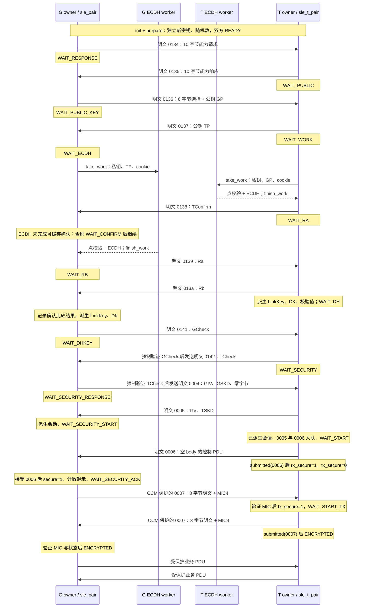

# 配对、密钥生命周期与链路加密实现

本文说明 E310 的 G/T 节点如何生成配对密钥、启用链路加密，以及处理计数、重传和失败。适合修改协议代码或评估安全边界的开发者；运行步骤见 [密钥生成](key-generation.md)，模块位置见 [架构](architecture.md)。

G/T 表示连接角色。当前实现提供新连接的密钥协商和加密业务路径，**没有经认证的对端身份，也不提供 Just Works 配对的主动中间人防护**。`AuthReq=0x05` 中的 MITM 位不改变这一限制。报文编码、字节反转和派生方法以下文源码为准，不能由通用算法名称推导出完整协议能力。

下文使用以下术语：P-256 是本实现采用的椭圆曲线；ECDH 是椭圆曲线 Diffie–Hellman 密钥协商；CMAC 用于计算消息认证码，CCM 用于加密并认证载荷。MIC 指随密文传输的完整性校验值，AAD 指参与认证但不加密的附加数据，nonce 是每次加密使用的计数与会话参数组合。通用安全背景可查 [参考资料](references.md#r1)，本实现的能力与限制由源码和测试界定。

## 1. 节点与库入口的默认配对参数

节点程序与库入口选择不同的配对参数（variant）。集成时需区分两者：

| 入口或配置 | 实际选择 | 会话 AES 密钥的计算 | 明文计数继承 |
| --- | --- | --- | --- |
| `sle_gnode` 的 `main()`，没有指定 `--pair-variant` | `SLE_PAIR_V_COUNT_PLAIN = 0x200` | AES-CMAC 路径 | 是 |
| `sle_tnode` 的 `opt` 初值，交给 `main()` / `session_reset()` | `0x200` | AES-CMAC 路径 | 是 |
| `sle_g_runtime_init()`、`sle_t_runtime_init()`，没有 variant 参数的库入口 | `SLE_PAIR_PROFILE_WS63 = 0x300` | 单块 AES 路径 | 是 |
| G 的显式 `variant=0` | 合成测试配置 | AES-CMAC 路径 | 否；首次计数为 0 |

实现：[sle_gnode.c](../sle-rt/sle_gnode.c) `main()`、`parse()`；[sle_tnode.c](../sle-rt/sle_tnode.c) `opt`、`parse()`、`session_reset()`；[sle_g_runtime.c](../sle-rt/sle_g_runtime.c) `sle_g_runtime_init()`；[sle_t_runtime.c](../sle-rt/sle_t_runtime.c) `sle_t_runtime_init()`；[sle_pair.h](../sle-rt/sle_pair.h) `SLE_PAIR_V_*`。

因此，集成代码应明确选择 variant，不能仅凭 `PROFILE_WS63` 的名字认为它等于节点程序的当前默认值。T 初始化只接受 `0x200`、`0x300`。G 还保留密钥反转、SKD/IV 顺序、nonce/MIC 反转等实验位，允许范围为 `0x3ff`，但拒绝同时设置 `COUNT_PLAIN` 和 `CTR1`。这些是显式诊断选择；正常接收不会在 MIC 失败后自动切换算法并接受报文。G CLI 可按用户提供的列表在不同连接尝试中选择 variant，这也不等于一次连接内的安全降级协商。

CMAC 路径用于 SDK 1.10.108 互通，单块 AES 路径作为兼容选项保留。兼容范围仍取决于对端固件与配置，不能仅凭选项名称判断。实现：[sle_pair.c](../sle-rt/sle_pair.c) `sle_pair_init()`、`session()`；[sle_t_pair.c](../sle-rt/sle_t_pair.c) `sle_t_pair_init()`、`session()`。

## 2. 密钥与随机材料的生命周期

每个配对上下文生成独立材料，并在派生完成或连接结束时分阶段清理。不同材料的用途与公开边界如下。

### 2.1 生成、传递与用途

公钥与部分随机参数会在空口交换；私钥、共享秘密和派生密钥必须保持秘密。

| 材料 | 长度与当前存储形式 | 生成或来源 | 存活阶段与公开边界 |
| --- | --- | --- | --- |
| 本端 P-256 私钥 | 32 字节，大端 `private_be` | `prepare()` 中 Mbed TLS `mbedtls_ecp_gen_keypair()` | 只用于当前配对的 ECDH；不可公开 |
| 本端、对端公钥 | 各 64 字节，`X_le32 \|\| Y_le32` | 本端生成；对端来自 `0136` / `0137` | 空口交换；可公开，但不构成身份凭据 |
| ECDH 共享点的 x 坐标 | 32 字节，小端 `dh_le` / `dh` | `sle_pair_run_work()` | 配对派生材料；不可公开 |
| `Ra`、`Rb` | 各 16 字节 | G/T 各自 `prepare()` 的随机源 | 在 `0139` / `013a` 中明文交换；是新鲜度材料，不是私钥 |
| `GIV \|\| GSKD`、`TIV \|\| TSKD` | 每方 12 字节，其中 IV 4 字节、SKD 8 字节 | 各自 `prepare()` 的随机源 | 在 `0004` / `0005` 中交换；不能单独作为会话密钥 |
| worker cookie | 16 字节 | 各自 `prepare()` 的随机源 | 本机作业关联，不发到空口，不参与 KDF |
| `LinkKey`、中间 `DK` | 各 16 字节 | 反转字节约定下的 AES-CMAC | LinkKey 用于当前会话派生；没有持久化配对绑定（bond）数据库 |
| G/T DH 校验值、T 确认值 | 各 16 字节 | 见 §3 | 空口握手值；不是业务 CCM MIC |
| `key`、`iv` | AES 密钥 16 字节、IV 8 字节 | `session()` | 保存到连接结束；密钥不可公开，IV 不应被误标为密钥 |
| T 的 `probe_key[6][16]` | 六个 16 字节候选密钥 | T `session()` | 为 MIC 故障诊断额外保存；全部按秘密材料处理 |

实现：[sle_pair.c](../sle-rt/sle_pair.c) `keygen()`、`sle_pair_take_work()`、`sle_pair_run_work()`、`derive_pair_keys()`、`session()`；[sle_t_pair.c](../sle-rt/sle_t_pair.c) `sle_t_pair_prepare()`、`sle_t_pair_take_work()`、`derive()`、`session()`；结构定义见 [sle_pair.h](../sle-rt/sle_pair.h)、[sle_t_pair.h](../sle-rt/sle_t_pair.h)。固定合成测试材料的生成方法见 [密钥生成](key-generation.md)。

### 2.2 随机源、线程所有权与连接重建

G/T 运行时层（runtime）的 `os_random()` 循环填满请求缓冲区，优先调用 Linux `getrandom()`，仅在 `ENOSYS` 时改读初始化阶段已经打开的 `/dev/urandom`；遇到 `EINTR` 重试，其余失败或零长度读取返回错误。初始化即使尚未使用回退路径，也要求成功打开 `/dev/urandom`。失败不会改用测试种子。[sle_g_runtime.c](../sle-rt/sle_g_runtime.c)、[sle_t_runtime.c](../sle-rt/sle_t_runtime.c)：`os_random()`、`sle_*_runtime_init_variant()`。

配对模块直接使用配置中的随机数生成器（RNG）回调生成密钥对和随机材料，并为 ECDH 运算提供盲化随机数。它不依赖 [sle_crypto.c](../sle-rt/sle_crypto.c) `sle_crypto_set_rng()` 的进程全局状态；通用 P-256 包装函数有自己的默认 `/dev/urandom` 回调，不能将其与 runtime 的 `getrandom()` 路径混为一谈。[sle_pair.c](../sle-rt/sle_pair.c)：`rng_call()`、`keygen()`、`sle_pair_run_work()`；[sle_t_pair.c](../sle-rt/sle_t_pair.c)：`rng()`、`sle_t_pair_prepare()`。

所有状态机、自动重传请求（ARQ）和计数修改在连接所属线程（owner）中串行进行。后台工作线程（worker）承担公钥校验和 ECDH 运算。

`take_work()` 把私钥复制到独立 work 对象，立即擦除配对对象内的私钥；worker 只接触 work/result，运行公钥校验和 ECDH。`finish_work()` 检查状态、有效标记和 cookie，消费并擦除 result。

G 允许在 ECDH 运行中缓存一个提前到达的 `0138`，但不会因此延长该步骤的计时。T 在接入前生成临时材料，随后 `sle_t_runtime_bind()` 只能在 READY、没有收发状态时绑定一次真实 G 地址与 sync。连接重建使用新的 init/prepare 生命周期。[sle_pair.c](../sle-rt/sle_pair.c)：`sle_pair_take_work()`、`sle_pair_finish_work()`、`dispatch()`；[sle_t_runtime.c](../sle-rt/sle_t_runtime.c)：`sle_t_runtime_bind()`、`work_main()`；[sle_tnode.c](../sle-rt/sle_tnode.c)：`session_reset()`。

### 2.3 擦除的实际范围

G 的 `derive_pair_keys()` 完成后擦除 ECDH 共享秘密和临时 DK；`session()` 完成后调用 `erase_pair_keys()` 擦除 LinkKey、随机数、校验材料等，仅留下会话 cipher 状态。G `fail()` 清除这些材料、cipher 和待发配对项。T `derive()` 同样清除 DH 与临时 DK，在 `0004` 处理完成、`0005/0006` 入队后调用 `secrets()` 清除配对秘密。相关擦除使用 `mbedtls_platform_zeroize()`。[sle_pair.c](../sle-rt/sle_pair.c)：`erase_pair_keys()`、`fail()`；[sle_t_pair.c](../sle-rt/sle_t_pair.c)：`secrets()`、`fail()`、`dispatch()`。

**清理限制：T 的 `secrets()` 和 `fail()` 都没有擦除 `probe_key`。** 它包含当前/候选会话密钥，直到 `sle_t_pair_clear()` 或 runtime 完整销毁时才随整个对象清零。因此“MIC 失败后立即清除了全部密钥”不符合当前实现。G 的失败擦除也不是整个对象清零；完整清理应使用 `sle_pair_clear()`，并清除调用者持有的明文队列和临时缓冲区（scratch）。

G/T runtime 销毁时先通知 worker，并通过 join 等待线程结束，再清理 work/result、pair、RNG 文件描述符和 runtime 存储。join 出错时直接返回，调用者必须保留仍可能被线程引用的存储，不能立即释放或关闭 RNG 上下文。节点退出路径先停止无线工作，再销毁 crypto runtime。这是内存生命周期约束，不是对 core dump、swap、日志、进程内任意复制或操作系统被攻破后的秘密保护保证。[sle_g_runtime.c](../sle-rt/sle_g_runtime.c)、[sle_t_runtime.c](../sle-rt/sle_t_runtime.c)：`sle_*_runtime_destroy()`；[sle_gnode.c](../sle-rt/sle_gnode.c)、[sle_tnode.c](../sle-rt/sle_tnode.c)：`main()`。

## 3. P-256、公钥确认与密钥派生

以下公式对应配对层的字节序与拼接方法，逐步从 ECDH 结果得到 LinkKey、校验值和会话密钥。

### 3.1 编码与基础运算

以下 `||` 表示字节拼接，`R(x)` 表示**整个输入字节串**反转，`x[a:b]` 为从 a 开始、不含 b 的切片。`CMAC(K,M)` 使用 AES-128，输出 16 字节；`AES(K,B)` 是 16 字节输入块的一次 AES-128 加密。

配对层定义：

```text
CR(K, M) = R(CMAC(R(K), R(M)))       K 恰为 16 字节
Public_le = R(X_be32) || R(Y_be32)
DH_le = R(ECDH_shared_x_be32)
```

公钥空口串没有 SEC1 的 `0x04` 前缀。worker 把两个小端坐标分别转回大端，临时构造 65 字节 SEC1 非压缩点，用 `mbedtls_ecp_point_read_binary()` 和 `mbedtls_ecp_check_pubkey()` 校验；还调用 `mbedtls_ecp_check_privkey()` 校验本端标量，再调用 `mbedtls_ecdh_compute_shared()`。收到与本端公钥完全相同的对端公钥会在进入 worker 前被拒绝。共享结果只取点的 x 坐标。

实现：[sle_pair.c](../sle-rt/sle_pair.c) `cmac_reverse()`、`keygen()`、`sle_pair_run_work()`、`dispatch()`；[sle_t_pair.c](../sle-rt/sle_t_pair.c) `mac()`、`sle_t_pair_prepare()`、`dispatch()`。算法运算由 [sle_crypto.c](../sle-rt/sle_crypto.c) `sle_aes_cmac()`、`sle_aes128_encrypt_block()` 等包装 Mbed TLS；字节序与协议拼接由项目配对层处理。

### 3.2 能力报文中的“支持”和“选定”

配对控制报文统一为 `opcode_le16 || body_len_u8 || body`，接收要求总长严格等于 `3 + body_len`。G 请求 `0134` 和 T 响应 `0135` 的本地 body 均为 10 字节：

```text
偏移     0   1   2   3   4   5   6   7   8   9
本地值   3   0   5  16   0   2   2   2   2   0
```

偏移 0 是 IO capability，偏移 1 为 OOB 标志，偏移 2 为 AuthReq，偏移 3 为密钥长度能力。偏移 5..8 是四个算法能力 bitmap；`2` 表示相应 bit1，不能把 bitmap `3` 理解为“选了算法 3”。代码只接受偏移 4、9 为零，未给这两个字段命名。G 随后的 `0136` 使用 6 字节选定参数 `16, 1, 2, 2, 2, 2`，再接 G 公钥 64 字节：长度、配对方式值及四个算法选择是标量，不再是能力 bitmap。

G `negotiate()` 接受 IO 0..4、对端密钥长度能力至少 16、四个能力字段包含 bit1 且保留位合法；实际仍选择 16 字节密钥和当前算法组合。T `dispatch(0134)` 更窄：AuthReq 必须为 5、长度必须为 16，其他限制见 §7；`0136` 的六个选定字节必须精确匹配。本地 IO=3 的路径按源码使用 Just Works，不提供数字比较、口令或外部身份确认 UI。实现：[sle_pair.c](../sle-rt/sle_pair.c) `request`、`negotiate()`、`dispatch()`；[sle_t_pair.c](../sle-rt/sle_t_pair.c) `dispatch()`；[test_sle_pair.c](../tests/test_sle_pair.c) `validation()`；[test_sle_t_protocol.c](../tests/test_sle_t_protocol.c) `g_to_t()`、`main()`。

### 3.3 T 确认、LinkKey、DK 与双向 DH 校验

设 `GP`、`TP` 是 64 字节小端公钥串；`GA`、`TA` 是配置中用于接入的 6 字节地址串，按内存原顺序拼接：

```text
TConfirm = CR(Rb, GP || TP)
Kdh      = DH_le[0:16]
LinkKey  = CR(Kdh, ASCII("kl") || Ra || Rb || GA || TA)
DK       = CR(Kdh, ASCII("kd") || Ra || Rb || GA || TA)
```

这里的消息前缀按代码内存顺序是 `"kl"` 与 `"kd"`，消息长度为 46 字节。**32 字节共享秘密只使用小端串前 16 字节作为这两次 CMAC 的 key。** C 参数传入 `dh_le` / `dh` 的地址，但 `cmac_reverse()` / `mac()` 只反转并使用 16 字节；不是 AES-256，也不是先对 32 字节做 HKDF。[sle_pair.c](../sle-rt/sle_pair.c)：`derive_pair_keys()`；[sle_t_pair.c](../sle-rt/sle_t_pair.c)：`derive()`。

G/T 校验消息都为 53 字节，布局如下：

| 偏移 | 长度 | 内容 |
| --- | --- | --- |
| 0 | 16 | G 校验用 Ra；T 校验用 Rb |
| 16 | 16 | 全零 |
| 32 | 1 | G 的 IO capability |
| 33 | 1 | T 的 IO capability |
| 34 | 1 | 固定值 1 |
| 35 | 4 | 四个字节均为 2 |
| 39 | 2 | 全零 |
| 41 | 6 | GA，原配置字节顺序 |
| 47 | 6 | TA，原配置字节顺序 |

对这两个消息分别计算 `GCheck = CR(DK, M_G)`、`TCheck = CR(DK, M_T)`。G 经 `0141` 发送 GCheck，并强制比较 `0142` 的 TCheck；T 强制比较收到的 GCheck，再发送 TCheck。不匹配进入 `SLE_PAIR_ERR_DHKEY`。这些校验绑定当前 DH、随机数、IO 和配置地址，但地址不是证书或长期可信身份。[sle_pair.c](../sle-rt/sle_pair.c)：`derive_pair_keys()`、`dispatch(0142)`；[sle_t_pair.c](../sle-rt/sle_t_pair.c)：`derive()`、`dispatch(0141)`。

**TConfirm 比较不是强制门槛。** T 在 ECDH 完成后发送 `0138` 的 TConfirm；G 收到 Rb 后才重算并将比较结果写入 `confirm_matches`，不匹配仍继续发送 GCheck。`-1/0/1` 分别表示未知/不匹配/匹配。G 强制执行的是后续 DH 校验。测试包含“错误确认值仍能在正确 TCheck 后继续”的用例，因此这里的 DH 校验不构成经过身份认证的密钥交换。[sle_pair.c](../sle-rt/sle_pair.c)：`derive_pair_keys()`；[test_sle_pair.c](../tests/test_sle_pair.c)：`validation()`。

### 3.4 会话 AES 密钥与 IV

`0004` 的 13 字节 body 是 `GIV(4) || GSKD(8) || 0x00`，最后一字节在当前路径固定为零；T 对它做检查。`0005` 的 12 字节 body 是 `TIV(4) || TSKD(8)`。令：

```text
SKD = GSKD || TSKD                          16 字节
K_CCM(0x200) = CMAC(R(LinkKey), R(SKD))     16 字节
K_CCM(0x300) = AES(R(LinkKey), R(SKD))      16 字节
IV = (GIV XOR LE32(sync_low32)) || TIV     8 字节
```

G 实现先计算小端中间 `sk_le`，再反转成为 `cipher.key`；上面的式子已经化简为最终实际传给 CCM 的 key。T 直接把所选计算结果复制到 `key`。当前节点默认的 `0x200` 使用 CMAC，即使输入恰为一块，也不能改写成单块 AES。sync 参数使用完整低 32 位同步字，不应把 24 位 LID 直接塞进来；G 节点通过 `sle_sync32_from_lid()` 得到它，T 绑定调度结构的 `sync32`。

实现：[sle_pair.c](../sle-rt/sle_pair.c) `session()`；[sle_t_pair.c](../sle-rt/sle_t_pair.c) `session()`、`dispatch(0004)`；[sle_gnode.c](../sle-rt/sle_gnode.c) `main()`；[sle_tnode.c](../sle-rt/sle_tnode.c) `connection()`。上述公式仅适用于所列两个 variant，不覆盖 G 的其他实验位组合。

## 4. G/T 状态机与加密启用时序

图中 `0134` 等均为十六进制 opcode。状态名分别省略 `SLE_PAIR_` / `SLE_T_PAIR_` 前缀。worker 为两端独立的 ECDH 工作，不共享配对对象。图展示正常握手的逻辑顺序；ARQ 重试、普通控制和允许的 CMTC 能力交换可能穿插其中。



状态与报文实现：[sle_pair.c](../sle-rt/sle_pair.c) `sle_pair_start()`、`dispatch()`、`sle_pair_finish_work()`、`sle_pair_protect()`；[sle_t_pair.c](../sle-rt/sle_t_pair.c) `dispatch()`、`sle_t_pair_finish_work()`、`sle_t_pair_submitted()`。

加密切换有以下边界：

- G 的 `secure=1` 早于 `ENCRYPTED`：等待最后 `0007` 时，TX 仅允许受保护的启动 `0007`；普通 DATA 还不能交付。G 收到 `0133` 时也可从 READY 启动请求，但节点通常由连接循环主动调用 `sle_g_runtime_start()`。
- T 的 RX/TX 分开切换：提交明文 `0006` 才打开 RX CCM；验证 G 的受保护 `0007` 才打开 TX CCM。T 在自己的受保护 `0007` 被 `submitted()` 确认后进入 ENCRYPTED，**该事件不是对端 ARQ ACK**。
- `0006` / `0007` 虽然 body 长度为零，完整控制 PDU 仍有 3 字节，必须计数；受保护 `0007` 在线上是 7 字节。它们不是物理 empty 帧。
- `ENCRYPTED` 表示本机状态机完成，不表示业务已获对端处理或拥有应用层授权。G 的 `sle_g_runtime_accepted()` 在请求 SSAP 验收时还要求 SSAP 校验与保护业务收发等条件。

实现：[sle_g_runtime.c](../sle-rt/sle_g_runtime.c) `sle_g_runtime_encrypted()`、`sle_g_runtime_accepted()`；[sle_t_runtime.c](../sle-rt/sle_t_runtime.c) `sle_t_runtime_encrypted()`；两端配对 `dispatch()` 与 T `sle_t_pair_submitted()`。

## 5. CCM 的保护边界、计数器与重传

每个方向使用自己的计数器。正确的计数继承与缓存复用，是双方验证 MIC 的必要条件。

### 5.1 线上构造

配对层把完整控制或数据 PDU 作为明文输入，输出密文和 4 字节 MIC：

| 项目 | 当前 `0x200` / `0x300` 的行为 |
| --- | --- |
| 算法 | AES-128-CCM，最终 key 来自 §3.4 |
| AAD | **一个字节 `0x00`**，长度为 1；不是空 AAD |
| nonce | 13 字节：5 字节计数/方向字段，再接 8 字节 IV |
| 计数与方向 | `nonce[0:5] = LE40(counter \| (direction << 39))`，counter 仅占低 39 位 |
| 方向值 | G→T 为 1；T→G 为 0。T 的 TX/RX 相对 G 反向设置该位 |
| MIC | 4 字节，直接附在密文后；当前两个 variant 不反转 MIC |
| 线上载荷 | `ciphertext(PDU_plain) \|\| MIC4`；不额外传输 nonce 或 counter |
| 控制保护范围 | 完整 `opcode_le16 \|\| len_u8 \|\| body` 都作为 CCM 明文输入 |
| 数据保护范围 | 传入配对 TX 的完整数据 PDU，包括已经组装的 SDU 分段头；不是只加密业务 value |
| 物理 empty | 绕过配对加解密，无 MIC、无 counter 消耗；不清除上一非空包缓存 |

实现：[sle_pair.c](../sle-rt/sle_pair.c) `nonce()`、`sle_pair_protect()`、`decrypt()`；[sle_t_pair.c](../sle-rt/sle_t_pair.c) `nonce()`、`sle_t_pair_tx()`、`sle_t_pair_rx()`；[sle_g_runtime.c](../sle-rt/sle_g_runtime.c)、[sle_t_runtime.c](../sle-rt/sle_t_runtime.c) `sle_*_runtime_tx()`、`sle_*_runtime_rx()`。

**保护边界：固定 AAD 没有纳入外层 SN、NESN、ptype、flow 等链路头字段。** 它们仍由链路/状态检查约束，但不能称为通过 CCM 认证。控制/数据分类也不是 nonce 的一部分。重复包缓存会额外核对类别，不过这不等于对新包外层类别做密码学绑定。empty 帧亦可经 runtime 传给链路处理，因此 ACK 统计不是独立的密码学收据。此结论来自上述实际传给 CCM 的参数及 runtime 调用顺序，不代表一次完整的头字段攻击可利用性验证。

配对核心上限为 `SLE_PAIR_WIRE_MAX=2047`、`SLE_PAIR_PLAIN_MAX=2043`，控制通用输入最大为 258 字节（不含 MIC）。节点 runtime 的 TX 上限是 **96 字节，包含 MIC**，因此受保护单次 TX 的明文上限为 92 字节，数据分段头还要占其中空间。不要把核心数组容量当成节点单包业务容量。[sle_pair.h](../sle-rt/sle_pair.h)：对应宏；[sle_g_runtime.h](../sle-rt/sle_g_runtime.h)：`SLE_RT_TX_MAX`；两端 runtime 的 `queue()` / `tx()`。

### 5.2 为什么首个加密包的计数不固定为零

两方向各自维护一个 `tx_next` / `rx_next`，同一方向的控制和 DATA 共用计数位置，不能按业务通道各建一套。`0x200` / `0x300` 都继承**该连接此前接受或提交的非空明文 PDU 数**，包括普通控制、配对控制、CMTC DATA 和明文 `0006`；重试和物理 empty 不重复计数。

G runtime 在首次实际提交某明文 PDU 后增加 `plain_tx`；RX 成功且不是 duplicate 时增加 `plain_rx`。收到 `0006` 后，先把它计入 RX，再调用 `sle_pair_seed_plain_counters()`，只允许在 WAIT_SECURITY_ACK、尚未保护任何包且未 seed 时执行一次。T 的 pair 对象从一开始就维护计数：明文 TX 在 `sle_t_pair_submitted()` 首次调用时增加，RX 在格式/状态等校验成功后增加，切换时无需另做 seed。[sle_g_runtime.c](../sle-rt/sle_g_runtime.c)：`sle_g_runtime_submitted()`、`sle_g_runtime_rx()`；[sle_pair.c](../sle-rt/sle_pair.c)：`sle_pair_seed_plain_counters()`；[sle_t_pair.c](../sle-rt/sle_t_pair.c)：`sle_t_pair_rx()`、`sle_t_pair_submitted()`。

合成对话测试中，仅握手得到 G 明文 TX/RX 数 5/7；加入双向 CMTC 请求/响应后为 7/9。它们是特定测试序列的结果，**不是可写死的协议常量**；额外普通控制会改变首个受保护包使用的计数。[test_sle_t_protocol.c](../tests/test_sle_t_protocol.c)：`handshake()`、`pair_loop()`、`cmtc_dialogue()`。

受保护新 TX 在首次**生成并缓存密文**时便消耗计数，而不是等 radio 提交或 ACK 后才增加。若时序导致此次发送跳过，缓存仍保留；下次必须复用同一密文。G runtime 特意用自己的 `tx_cached` 判断是否已保护，不能直接使用可能把“从未发出的事件”也标为重传的 link `retx`。T 也由 runtime 缓存状态传递 retx；其 `tx_submitted` 还阻止上一包尚未提交时开始新的包。[sle_g_runtime.c](../sle-rt/sle_g_runtime.c)：`sle_g_runtime_tx()`；[sle_t_pair.c](../sle-rt/sle_t_pair.c)：`sle_t_pair_tx()`；[sle_gnode.c](../sle-rt/sle_gnode.c)：`connection()`。

计数上限为 `2^39`：允许生成/验证计数 `2^39-1` 的最后一个新包，之后拒绝新包，不回卷；既有最后一包的合法重传仍可用缓存处理。没有自动刷新会话或恢复窗口。实现：[sle_pair.c](../sle-rt/sle_pair.c) `sle_pair_protect()`、`decrypt()`；[sle_t_pair.c](../sle-rt/sle_t_pair.c) `sle_t_pair_tx()`、`sle_t_pair_rx()`；[test_sle_pair.c](../tests/test_sle_pair.c) `data_channel()`。

### 5.3 发送重传与重复接收

发送重传复用密文，重复接收（duplicate）避免再次交付；G/T 的重复包验证方法不同。

| 场景 | G | T |
| --- | --- | --- |
| TX 重传 | SN、明文长度与字节必须匹配当前缓存；直接返回已缓存密文 | 还检查 ptype；匹配后返回原 wire，包括跨安全切换仍需重传的明文包 |
| 新 TX | 已有非空 TX 后 SN 必须翻转 | SN 必须翻转，且上一包必须已 submitted |
| 受保护 RX duplicate | 使用 `rx_next-1` **再次验证 MIC**，再核对原密文字节、长度与控制/数据类别 | 核对 SN、ptype、长度和已接受 wire 完全相同；**不再次调用 CCM**，继承缓存首次接收的验证结果 |
| 成功 duplicate | 返回 `SLE_PAIR_DUPLICATE`，输出长度为零，不交付第二次，不增加 counter | 同左 |
| 新 RX 的旧密文重放 | 使用下一 counter，通常 MIC 失败；不搜索可接受的已用计数窗口 | 同左；诊断探测也不改变拒绝结论 |

G 的明文控制重传要求与最近一次明文控制缓存及 SN 一致；加密切换后只额外允许**紧邻的明文 `0006`**在 WAIT_SECURITY_ACK、尚未接受任何受保护 peer PDU 时重传。接受一个受保护新包后，G 清除该明文重传缓存。T 保留最近一个已接受包及其 `rx_cached_secure` 分类；duplicate 分支在解密前执行，精确匹配的旧明文缓存可以在切换边界使用，但不会再次 dispatch 或增加计数。

实现：[sle_pair.c](../sle-rt/sle_pair.c) `sle_pair_protect()`、`decrypt()`、`sle_pair_on_control_ex()`；[sle_t_pair.c](../sle-rt/sle_t_pair.c) `sle_t_pair_tx()`、`sle_t_pair_rx()`；[sle_t_runtime.c](../sle-rt/sle_t_runtime.c) `sle_t_runtime_rx()`。

### 5.4 必须沿用的调用顺序

接收路径先验证受保护载荷，再更新链路状态。修改节点或复用 runtime 时，必须保留这一顺序。

| 路径 | 节点 / runtime / 配对调用链 |
| --- | --- |
| G TX | `sle_gnode:connection()` → `sle_g_runtime_tx()` → `sle_pair_protect()` → 编码/提交 → `sle_g_runtime_submitted()` |
| G 控制 RX | `connection()` → `sle_g_runtime_rx()` → `sle_pair_on_control_ex()`（一次解密与分类）→ `sle_link_on_rx()` |
| G 数据 RX | `sle_g_runtime_rx()` → `sle_pair_unprotect()` → `sle_link_on_rx()` → 已去重 DATA 交 SDU/SSAP |
| T TX | `sle_tnode:connection()` / `predictive_loop()` → `sle_t_runtime_tx()` → `sle_t_pair_tx()` → 提交路径 → `sle_t_runtime_submitted()` → `sle_t_pair_submitted()` |
| T RX | `sle_t_runtime_rx()` → `sle_t_pair_rx()` → `sle_link_on_rx()` → 已去重控制或 SDU/SSAP |

源码：[sle_gnode.c](../sle-rt/sle_gnode.c)、[sle_tnode.c](../sle-rt/sle_tnode.c)、[sle_g_runtime.c](../sle-rt/sle_g_runtime.c)、[sle_t_runtime.c](../sle-rt/sle_t_runtime.c)；函数名见表。T predictive 路径提前准备发送，完成该事件的发送观察策略后调用 submitted，再处理收到的 G 包；submitted 表示本地提交生命周期，不能当成对端已收到。

RX 的 duplicate 必须从**更新前**的 ARQ 状态推导，当前为非空包的 `sn != l->arq.rx_nesn`。有受保护载荷时先验证/检查缓存，再进入 `sle_link_on_rx()`；坏 MIC 不得借报头的 NESN 确认本端待发包，也不得刷新 supervision。CRC body 失败的非空包被忽略。普通控制不推进配对步骤、不替代 G 的配对 transcript，但仍占同一 ARQ/计数序列；不能先解密控制，再把明文交给本来接收 wire 的 `on_control_ex()`。

## 6. 加密前允许的 CMTC 能力交换

普通业务 DATA 在握手完成前被拒绝，但当前实现允许固定形式的 CMTC 能力请求/响应穿插配对。接收例外要求 ptype=0、尚未启用该方向加密、完整且未分段的两字节 SDU 头，以及以下布局：

| 项目 | 接收匹配条件 / 本地生成值 |
| --- | --- |
| DTAP TCID | `0x0002` |
| 请求 SDU | 12 字节；DTAP 长度 8、CM code=1、CM body 长度 4、bitmap=`0x000000a0` |
| 响应 SDU | 16 字节；DTAP 长度 12、CM code=2、CM body 长度 8、同一 bitmap |
| identifier | 匹配函数允许任意一个字节；回复回显请求 identifier |
| 响应参数 | 本地发 MPS=90、version=`0x0101`，两个字段均为小端 16 位；接收匹配允许字段取任意值 |
| 完整 PDU 长度 | 请求 14 字节、响应 18 字节，含两字节 SDU 头 |

[sle_cmtc.c](../sle-rt/sle_cmtc.c)：`request_sdu()`、`response_sdu()`、`pdu_header()`、`sle_cmtc_capability_req_pdu()`、`sle_cmtc_capability_rsp_pdu()`、`sle_cmtc_capability_reply()`、`sle_cmtc_capability_parse_rsp()`；常量见 [sle_cmtc.h](../sle-rt/sle_cmtc.h)。这些是程序接受的形式，不是任意 CMTC 实现的通用支持声明。

G 由 `sle_g_runtime_rx()` 特判此 DATA；T 由 `sle_t_pair_rx()` / `sle_t_pair_tx()` 特判。G 的明文 TX runtime 本身没有与 T 相同的业务白名单检查，当前节点通过只在加密完成后排队 SSAP 等业务来约束发送；复用 G runtime 的调用者也必须保留这条约束。代码未在 CMTC parser 中把 response identifier 与某个 pending request 关联，因此这是格式兼容处理，不是经认证的能力协商。G 的明文 CMTC duplicate 也未进入 pair 的逐字节明文控制缓存检查；其去重依赖 link ARQ。

请求、响应都计入明文计数；不能为了“只有配对消息才算”而过滤它们。改变 bitmap、错误长度、ptype=2 或以此包装普通 SSAP，均不满足加密前 DATA 例外。启用加密后，同样的明文 CMTC 字节不会触发回退，而要走 CCM 验证。节点处理点：[sle_gnode.c](../sle-rt/sle_gnode.c) `ssap_on_sdu()`、`connection()`；[sle_tnode.c](../sle-rt/sle_tnode.c) `on_sdu()`、`connection()`；测试见 §9。

## 7. 输入校验与失败处理

G/T 对能力字段、报文状态和错误原因的检查并不完全相同。下表列出各自接受的范围。

| 检查点 | G 的实际行为 | T 的实际行为 |
| --- | --- | --- |
| 连接身份参数 | 收包参数必须等于配置的 TA | 必须等于绑定的 GA；不是空口证书验证 |
| 控制总长 | 至少 3 字节，严格满足声明长度；受保护控制先验 MIC | 同样校验明文控制长度；新包先按方向开关解密 |
| 能力合法性 | IO≤4、OOB≤1、AuthReq 高四位为零且低两位≤1；其他保留位掩码检查；长度至少 16 | `0134` 要求 IO≤4、OOB=0、AuthReq=5、长度=16、偏移 4/9 为零 |
| 能力支持范围 | 拒绝 OOB、AuthReq bit3、非零偏移 4/9；四算法必须包含 bit1 | 四算法必须包含 bit1，前两个不得设置高四位，后两个不得设置高六位 |
| 选定参数 | 本地构造固定 `16,1,2,2,2,2` | 收到 `0136` 时六字节必须精确一致 |
| 公钥 | 拒绝反射本端公钥；worker 校验曲线点、标量 | 同样使用共享 worker 实现 |
| DH 校验 | `0142` 必须匹配 expected TCheck | `0141` 必须匹配 expected GCheck |
| 安全启动 | 各 opcode 必须在对应状态、精确长度下出现；必须先保护自己的 `0007` 才接受最后 `0007` | `0004` body 必须为 13 字节且末字节零；`0007` 要求 RX 已 secure 且零 body |
| 未支持的配对 opcode | `0004..0009`、`0133..0149`、`01ff` 进入配对路由；未实现分支失败，包括刷新 `0008/0009` | 同一路由范围，未实现分支失败 |
| 远端失败 | `01ff` / `0147` 要求 body 长 1、reason=1..11，记录 remote reason | 只要通用控制长度自洽，直接报告 REMOTE；没有同等 reason 范围校验 |
| 超时 / 时钟 | active 时默认步骤 5 秒、总计 30 秒；时钟倒退失败 | 同样默认值；T 从接受 `0134` 开始 active |
| API 容量 / 参数错误 | 通常返回 BUFFER/ARGUMENT，不消耗 counter、不输出未认证明文 | 同类错误通常不终止 pair；但 runtime 把负返回记为本连接错误 |

实现：[sle_pair.c](../sle-rt/sle_pair.c) `negotiate()`、`dispatch()`、`sle_pair_tick()`、`sle_pair_on_control_ex()`、`decrypt()`；[sle_t_pair.c](../sle-rt/sle_t_pair.c) `dispatch()`、`sle_t_pair_tick()`、`sle_t_pair_rx()`；错误码见 [sle_pair.h](../sle-rt/sle_pair.h)。

G/T 解密使用私有 scratch，验证失败不把候选明文复制给调用者，输出长度为零；scratch 在离开相应路径前擦除。G 对受保护控制还在格式/dispatch 成功后才复制最终明文。若 MIC 正确但后续控制语义错误，G 内部可能已经推进过接收 cipher 状态，随后 `fail()` 清除 cipher 并终止连接；不能要求这种终止错误仍保留旧 counter。T 在完成格式与 dispatch 后才缓存 wire 并增加 RX counter。通用 [sle_crypto.c](../sle-rt/sle_crypto.c) `sle_aes_ccm_decrypt()` 则直接委托 Mbed TLS，任意参数错误下的输出缓冲区不能一概视为已清零。

协议/密钥/MIC/顺序等致命错误进入 FAILED 并保留首个错误。G 在 active、尚未 secure 且不是远端主动失败时，会在 pair 内部排队 `01ff` 失败通知；**节点不保证这个通知实际发出**：runtime 已记录负错误时 `sle_g_runtime_queue()` 会先返回，节点也会退出循环。T `fail()` 没有生成对端失败通知。G 头文件提到 MIC 错误的断链原因 27 是调用者要求，当前节点失败路径停止当前连接，不应据此声称已可靠发送该原因的断开控制。实现：[sle_pair.c](../sle-rt/sle_pair.c) `reason_for()`、`fail()`；[sle_g_runtime.c](../sle-rt/sle_g_runtime.c) `failed()`、`sle_g_runtime_queue()`；[sle_t_pair.c](../sle-rt/sle_t_pair.c) `fail()`；两端节点 `connection()`、`main()`。

T 在 MIC 失败后有额外诊断：枚举六种派生/反转候选、counter 0..63 和两个方向参数，最多尝试 768 次 CCM 验证，记录 `mic_probe` 的索引编码，仍返回 `SLE_PAIR_ERR_MIC` 并终止连接。它既不是接受窗口，也不是自动重同步；候选命中不交付明文。该路径增加失败时的计算成本，候选密钥清理限制见 §2.3。[sle_t_pair.c](../sle-rt/sle_t_pair.c)：`session()`、`sle_t_pair_rx()`；[sle_t_pair.h](../sle-rt/sle_t_pair.h)：`SLE_T_KDF_*`。

## 8. 威胁模型与未实现能力

下表把代码中的机制与由其推导出的安全边界分开列出。工程推论不等于密码学安全证明。

| 对手或故障 | 当前机制与适用条件 | 边界 / 尚未提供的能力 |
| --- | --- | --- |
| 被动监听业务 | 新连接临时 P-256 交换后派生 AES-CCM key；受保护业务不以明文 PDU 发送 | 安全依赖随机源、Mbed TLS、端点和密钥未泄露；元数据、明文握手仍可观察 |
| 篡改受保护载荷 | 新包必须通过 4 字节 MIC；失败不交付、不给坏包更新 ARQ 的机会 | MIC 为 32 位，不能表述为 128 位认证强度；未给出多次尝试的系统级风险预算或形式化证明 |
| 当前连接内旧包重放 | 隐式 39 位 counter 与最近一个包的 ARQ 缓存约束 | 没有持久化 防重放数据库、乱序接收窗口或跨重启恢复 |
| 主动中间人 / 冒充 | 地址与握手字段参与校验，错误 DH 校验失败 | Just Works 没有可信身份锚点；攻击者独立与双方建立会话不由本实现排除；TConfirm 在 G 端还只是诊断 |
| 伪造头部、empty、能力交换 | 状态/长度/ARQ 检查，CMTC 固定格式白名单 | 头部不在 AAD；empty 无 MIC；加密前 CMTC 和普通控制未认证，不能宣称全链路控制平面完整性 |
| 恶意断链或资源耗尽 | 配对超时、有限队列、计数耗尽后终止 | 没有抗射频干扰保证、配对请求身份授权或全面限流；T MIC 诊断有额外计算成本 |
| 端点、调试或日志泄露 | 私钥转移、阶段擦除、worker join 后销毁 | 没有安全元件、可信执行环境或进程被攻破后的保护；业务日志仍可含解密载荷 |
| 后来泄露长期身份秘密 | 每次 prepare 生成新临时私钥、没有 bond key 复用路径 | 这仅支持“实现意图为临时密钥生命周期”的判断；未作前向保密形式化分析或全副本擦除证明 |

表中机制依据 §2–§7 的函数；威胁后果是基于这些机制的工程推论。例如“地址被纳入 DH 校验”不能推出“地址所有者已认证”；“坏 MIC 不更新 ARQ”也不能推出“所有 ACK 都经密码学认证”。

当前没有实现：bonding 持久化及重连密钥恢复、IRK/地址分发、PSK、OOB、口令输入或数字比较、SM 算法套件、会话内安全刷新、证书/签名身份认证、完整的应用权限管理。`0008/0009` 的刷新请求会进入未支持分支。不能将白皮书、完整协议栈或对端 SDK 的能力当作本工程已经实现的功能。[sle_pair.h](../sle-rt/sle_pair.h)：模块能力说明；[sle_pair.c](../sle-rt/sle_pair.c)、[sle_t_pair.c](../sle-rt/sle_t_pair.c)：`dispatch()`。

公开程序没有运行时导出私钥/LinkKey 的接口，但正常业务诊断会记录应用内容：例如 G `on_sdu()` 记录解密后的 SDU payload，T `on_sdu()` 和交互输出记录/显示收到的业务。加密只保护规定的空口 PDU，不对这些日志提供静态加密。公开日志前仍需检查其中的敏感业务内容。[sle_gnode.c](../sle-rt/sle_gnode.c)：`on_sdu()`、`ssap_on_sdu()`；[sle_tnode.c](../sle-rt/sle_tnode.c)：`on_sdu()`；[密钥与日志处理](key-generation.md)。

## 9. 测试覆盖与证据的限度

本节说明测试源代码中的断言及其边界。执行结果见 [实现与验证范围](source-status.md)，指定二进制的空口效果见 [双角色功能验证](validation-results.md)。

| 测试文件 / 函数 | 源码中覆盖的行为 | 不能据此推导的结论 |
| --- | --- | --- |
| [test_crypto_synthetic.c](../tests/test_crypto_synthetic.c) `main()` | 合成 key/nonce/AAD 的 CCM 往返、MIC 篡改与失败输出检查；P-256 双方共享结果相同；全零点拒绝 | 其 CCM 参数为 7 字节 AAD、8 字节 tag，不是节点的 1 字节 AAD/MIC4 互通测试 |
| [gen_pair_vectors.py](../tests/gen_pair_vectors.py) `vectors()`、`--check` | 固定、明确仅测试的输入；Python cryptography/OpenSSL 独立生成公钥、DH、LinkKey、确认、校验、CMAC 会话及 CCM 预期；check 与 C 文件声明对照 | 默认生成的会话/计数序列针对 `variant=0` 的 CMAC、零初值假设，不覆盖所有 variant 或默认 runtime 行为 |
| [test_sle_pair.c](../tests/test_sle_pair.c) `happy_path()`、`validation()` | G 完整合成握手、字节序/派生预期；长度、保留位、能力、身份、状态、远端失败、DH 不匹配；确认不匹配仅诊断 | 不是身份认证证明；明确存在被接受的错误确认值 |
| 同文件 `worker_and_timeout()` | 无效点/反射公钥、提前确认、过期 cookie、RNG 失败、全局 RNG 隔离、步骤/总超时、时钟倒退、work/result 擦除 | 不等于遍历所有曲线输入、随机源故障或线程交错 |
| 同文件 `security_start()`、`data_channel()`、`unified_control()`、`plain_counter_api()` | 启动切换；MIC 篡改、重放、重复缓存、空帧、计数极值/耗尽、缓冲区和重叠输入输出；AAD 为空与单字节零的差别；控制/数据共用计数与分类；只 seed 一次 | 不等于空口恶意头部攻击或长时间多连接 nonce 唯一性验证 |
| [test_sle_g_runtime.c](../tests/test_sle_g_runtime.c) `authentication_and_retry()`、`switch_boundary()`、`count_plain_candidate()` | 认证前不改 ARQ/ACK/supervision；加密启动边界；跳过事件与重传；明文计数继承 | 固定会话快照并不能证明真实设备时序全部成立 |
| 同文件 `control_routing()`、`startup_control_routing()`、`ownership_and_limits()`、`worker_lifecycle()` | 普通控制路由、队列存储生命周期/容量、真实 worker 邮箱与错误/销毁分支 | 不是全面并发竞态或内存安全审计 |
| [test_sle_t_protocol.c](../tests/test_sle_t_protocol.c) `handshake()`、`pair_loop()`、`business()`、`main()` | G/T 本地对话；分别使用 `0x300` 和 `0x200` 完成握手与业务；比较 key/IV/计数；受保护 SSAP 往返 | 双方都来自本工程，可能共享同一理解错误；不能替代独立对端验证 |
| 同文件 `negative()`、`setup_errors()`、`runtime_checks()` | MIC 篡改、counter 错位仍拒绝、旧密文重放、缓冲区、身份、耗尽、RNG、超时、T worker/bind/destroy；坏 MIC 携 ACK 不改链路 | 非穷举负面测试；CMAC 分支的 `main()` 没有重复调用全部负面测试，不能称两条路径覆盖完全对称 |
| [test_sle_g_runtime.c](../tests/test_sle_g_runtime.c) `cmtc_capability()`；[test_sle_t_protocol.c](../tests/test_sle_t_protocol.c) `cmtc_unit()`、`cmtc_dialogue()` | CMTC 格式、标识符回显、参数解析、双向插入后计数、切换后拒绝明文、加密前拒绝其他 DATA | CMTC/SSAP 部分测试样本来自互通观察，不能把整个测试目录统称为独立合成密码向量 |

节点级测试还有 [test_sle_gnode.c](../tests/test_sle_gnode.c) 的 `main()` 与 [test_sle_tnode.c](../tests/test_sle_tnode.c) 的 `cli_defaults()`、`interactive_main_sigint()` 等，使用 stub 检查默认选项、交互和退出生命周期；这些断言不替代真实 CCM/射频验证。独立合成密码向量由生成器定义，使用方法见 [密钥生成](key-generation.md)。

### 尚未验证的安全边界

以下问题需要专门的安全分析或实验，现有单元测试和互通结果不足以回答。

1. 节点默认 `0x200` 的互通结果仅覆盖 [功能验证](validation-results.md)中列出的二进制与对端，尚不能推广到不同官方固件或配置。
2. G 确认值只诊断的设计取舍、T `probe_key` 延迟擦除及昂贵的失败探测，都需要专门安全审查。
3. 头部未纳入 AAD、empty ACK、未认证的 CMTC 与普通控制对整条连接的影响，需要专门攻击/故障注入测试，现有坏 MIC 测试不足以涵盖。
4. 缺少全面模糊测试（fuzzing）、故障注入覆盖率、侧信道评估、形式化安全论证及端点秘密全生命周期证明。有限单元测试断言、库算法实现、互通成功是三种不同证据，不能互相替代。
5. 当前错误路径不保证对端收到失败/断开通知；上层若依赖明确的关闭原因，需要另行实现并验证发送与退出之间的顺序。
